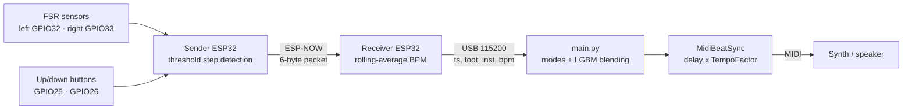
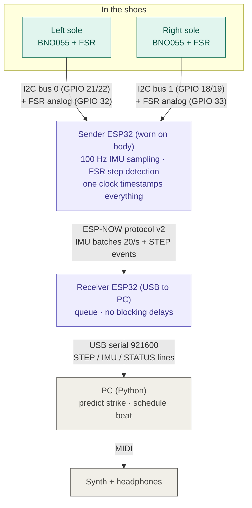
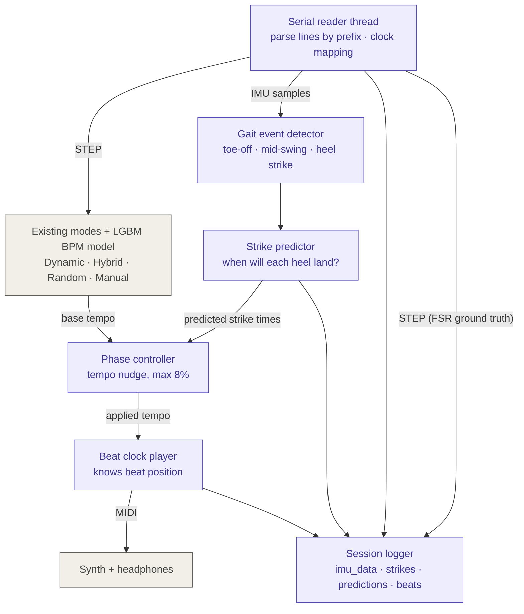
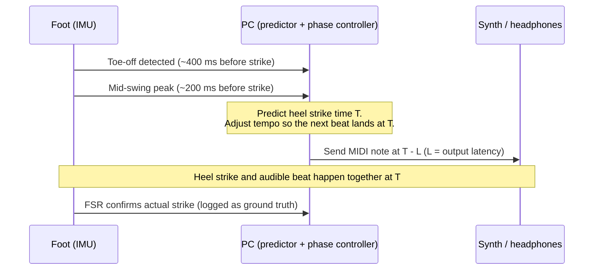

# IMU Integration Plan — Foot-Strike Prediction & Beat–Step Phase Alignment

> **Status:** Research / design plan — nothing in this document is implemented yet.
> **Scope:** Proof of concept (POC). Designed so it can be extended later (more sensors, more nodes).
> **Hardware decision:** Two Bosch **BNO055** IMUs, **one inside each shoe sole**, both wired to the **existing single sender ESP32**.
> **Starting point:** only **one** BNO055 is available now (the second is on order). The POC starts with a single IMU on one leg — see [§24.1](#241-starting-with-a-single-imu). Everything is designed per foot so adding the second IMU is configuration, not a redesign.
> **Software architecture explained with diagrams:** see [IMU_Software_Architecture.md](IMU_Software_Architecture.md).
> **Short summary of all decisions:** see [IMU_Research_Summary.md](IMU_Research_Summary.md).

---

## Table of Contents

1. [TL;DR](#1-tldr)
2. [Goals, Non-Goals and Success Metrics](#2-goals-non-goals-and-success-metrics)
3. [Background: Tempo vs. Phase, and the Gait Cycle](#3-background-tempo-vs-phase-and-the-gait-cycle)
4. [The Current System (As-Is) and Why It Cannot Do This Yet](#4-the-current-system-as-is-and-why-it-cannot-do-this-yet)
5. [Target Architecture (To-Be)](#5-target-architecture-to-be)
6. [Hardware](#6-hardware)
7. [BNO055 Configuration](#7-bno055-configuration)
8. [Sender Firmware (Foot ESP32)](#8-sender-firmware-foot-esp32)
9. [Wireless Protocol v2 (ESP-NOW)](#9-wireless-protocol-v2-esp-now)
10. [Receiver Firmware (PC-side ESP32)](#10-receiver-firmware-pc-side-esp32)
11. [Serial Protocol v2 (Receiver → PC)](#11-serial-protocol-v2-receiver--pc)
12. [Clock Synchronization](#12-clock-synchronization)
13. [Python Ingestion Layer](#13-python-ingestion-layer)
14. [Session Logging & Data Format](#14-session-logging--data-format)
15. [Gait Event Detection from Foot IMUs](#15-gait-event-detection-from-foot-imus)
16. [Foot-Strike Prediction](#16-foot-strike-prediction)
17. [Music Engine: Beat Clock and Phase Alignment](#17-music-engine-beat-clock-and-phase-alignment)
18. [Latency: Budget, Measurement and Compensation](#18-latency-budget-measurement-and-compensation)
19. [Integration with Existing Modes and the BPM Model](#19-integration-with-existing-modes-and-the-bpm-model)
20. [GUI Changes](#20-gui-changes)
21. [ML Pipeline Changes](#21-ml-pipeline-changes)
22. [Configuration Parameters](#22-configuration-parameters)
23. [Testing & Validation](#23-testing--validation)
24. [Phased Roadmap](#24-phased-roadmap)
25. [File-by-File Change List](#25-file-by-file-change-list)
26. [Risks & Mitigations](#26-risks--mitigations)
27. [Open Questions](#27-open-questions)
28. [Glossary](#28-glossary)
29. [References](#29-references)

---

## 1. TL;DR

Today the system matches the music's **tempo** (BPM) to the walker's cadence. It does **not** control **where the beats land** relative to the steps — a beat can fall anywhere between two footfalls.

The POC adds:

1. **Two BNO055 IMUs in the soles** (one per foot), wired to the existing sender ESP32, streaming raw gyroscope + accelerometer data at ~100 Hz with timestamps from the same clock as the FSR step events.
2. **Foot-strike prediction**: from the IMU swing-phase signal, predict *when the next heel strike will happen* for each foot, 100–400 ms in advance. FSRs (already in the soles) provide exact ground-truth strike times, which are used for free, automatic training labels and for evaluation.
3. **Phase alignment in the music engine**: the MIDI player is refactored to know its *position in beats*. A phase controller gently nudges the tempo so the next beat is heard exactly at the predicted heel strike (after subtracting measured system latency).

The work is staged so that the first deliverable (streaming + logging + offline analysis) answers the key question — *can IMUs predict strikes better than the current interval-based approach?* — before the music engine is touched.

---

## 2. Goals, Non-Goals and Success Metrics

### 2.1 Goals (POC)

| # | Goal |
|---|------|
| G1 | Stream IMU data from both feet to the PC reliably, with accurate shared timestamps. |
| G2 | Predict the time of each upcoming heel strike, per foot, before it happens. |
| G3 | Play the music so that beats coincide with heel strikes (phase alignment), not just at the same rate (tempo matching). |
| G4 | Log everything needed to evaluate G2 and G3 offline. |

### 2.2 Non-Goals (for this POC)

- Full 3-D orientation / sensor fusion, stride length, gait speed, trajectory (ZUPT-based dead reckoning). Possible later.
- Replacing the FSRs. They stay — they are the ground truth.
- Multi-node (one ESP32 per foot) architecture. Possible later (see [§26](#26-risks--mitigations) and [§27](#27-open-questions)).
- Productizing the standalone build.

### 2.3 Success Metrics

| Metric | Definition | POC target (initial — revisit after first data) |
|---|---|---|
| **Strike prediction MAE** | Mean \|predicted HS time − actual FSR HS time\|, measured at a fixed lead time (e.g. 150 ms before the strike) | ≤ 20 ms, and clearly better than the interval-extrapolation baseline |
| **Strike prediction P90** | 90th percentile of the absolute error above | ≤ 40 ms |
| **Beat–strike asynchrony** | Mean and SD of (audible beat time − actual heel strike time), measured acoustically ([§18.3](#183-end-to-end-asynchrony-measurement-the-real-test)) | \|mean\| ≤ 20 ms, SD ≤ 30 ms during steady walking |
| **Packet loss** | Fraction of missing IMU sequence numbers | < 1 % |
| **No regression** | Existing modes (Dynamic, Hybrid, Random, Manual) still work with phase alignment **off** | Pass |

> Rationale for the ~20–50 ms numbers: sensorimotor-synchronization research generally finds that people perceive and react to audio–movement asynchronies in the tens-of-milliseconds range. Treat these as starting targets and tune them with the supervisor.

---

## 3. Background: Tempo vs. Phase, and the Gait Cycle

### 3.1 Tempo vs. Phase ("the music thing")

- **Tempo** = *how fast* — beats per minute. Matching tempo to cadence means one beat per step on average.
- **Phase** = *where in the beat cycle* — whether the beat happens exactly at the footfall, 100 ms before it, or halfway between steps.

Two signals can have identical tempo and be completely out of phase. The term for locking both is **phase alignment** / **phase locking**; in rhythmic auditory stimulation (RAS) literature the resulting coupling of movement to music is called **entrainment**.

```
Tempo matched, phase WRONG:
  Steps:  |     |     |     |     |
  Beats:     |     |     |     |     |      (beats land between steps)

Tempo matched, phase ALIGNED (the goal):
  Steps:  |     |     |     |     |
  Beats:  |     |     |     |     |
```

### 3.2 Why prediction is required

Every part of the chain has latency (sensor → radio → serial → Python → MIDI → synthesizer → speaker; see [§18](#18-latency-budget-measurement-and-compensation)). If we wait for the heel strike to be *detected* and then play a beat, the beat is always late by the whole chain latency. To make the beat sound **at** the strike, the system must know the strike time **in advance** and schedule the beat ahead of time. FSRs fire only *at/after* contact, so they cannot give advance warning; an IMU sees the swing phase that **precedes** the strike.

### 3.3 Gait cycle primer (per foot)

```
 |<------------------------- one stride (same foot to same foot) ------------------------->|
 |<------------ STANCE (~60%) ------------>|<------------- SWING (~40%) ------------>|
 HS                                        TO          mid-swing                   HS
 (heel strike / initial contact)           (toe-off)   (peak foot rotation)        (next strike)
```

- **Heel strike (HS)** — foot contacts the ground. **This is the event the beat should coincide with.**
- **Stance** — foot is on the ground. For a foot-mounted IMU the foot is nearly motionless in mid-stance (angular velocity ≈ 0, acceleration ≈ gravity).
- **Toe-off (TO)** — foot leaves the ground. Visible as a strong push-off rotation.
- **Swing** — foot travels forward. The sagittal-plane (pitch) angular velocity has a large, very repeatable peak around **mid-swing**.
- **Step** = HS of one foot to HS of the other foot. **Stride** = HS to HS of the same foot (= 2 steps).
- Typical walking: stride ≈ 1.0–1.2 s, swing ≈ 0.35–0.45 s, so **TO gives ~400 ms of warning** and **mid-swing gives ~150–250 ms of warning** before HS.

With one IMU per foot we observe both feet's events directly, and the two feet's events interleave (left HS → right TO → right HS → left TO → …), which provides extra predictive features.

---

## 4. The Current System (As-Is) and Why It Cannot Do This Yet

### 4.1 Current data flow



### 4.2 Relevant facts and limitations (with file references)

| Area | Current behavior | Why it matters for this POC |
|---|---|---|
| Sender step message | Sends only `intervalMS` + `footId`, **no timestamp** ([step_detection_sketch.ino](../ESP32/step_detection_sketch/step_detection_sketch.ino), `Packet` struct) | Strikes can't be aligned with IMU samples without an absolute sender timestamp. |
| Sender debug prints | `Serial.println(triggeredFsr)` / `"sent"` on every step | Wasted time in the hot loop; remove. |
| Packet format | One fixed-size `union` `Packet`; receiver accepts only `len == sizeof(Packet)` ([step_receiver_sketch.ino:219](../ESP32/step_receiver_sketch/step_receiver_sketch.ino)) | Adding a larger IMU message to the union changes the size of **every** packet → old firmware rejects everything. Needs a versioned, per-type protocol. |
| Receiver mailbox | Single-slot `currentStep` + `messageRecv` flag set in the ESP-NOW callback | At 20+ packets/s, packets **overwrite each other** before `loop()` reads them → data loss. Needs a queue. |
| Receiver LED blink | `delay(50)` after every step ([step_receiver_sketch.ino:439](../ESP32/step_receiver_sketch/step_receiver_sketch.ino)) | Blocks the receiver 50 ms per step → adds latency and drops IMU data. Must be non-blocking. |
| Receiver sender filter | `senderMac` is stored but the callback does not check the source MAC | Fine for POC; note for later multi-node work. |
| Serial baud | 115200 in firmware and in Python ([main.py:279](../server/main.py), [main.py:370](../server/main.py), [gui_app.py:1550](../server/gui_app.py)) | ≈ 11.5 KB/s max. Text IMU stream for two feet at 100 Hz is ≈ 9–11 KB/s → saturated. Must go to 921600. |
| Python parser | `handle_step()` does `split(",")` into exactly 4 fields ([comms.py:92](../server/utils/hardware/comms.py)) | Any new line type raises `ValueError` and is silently skipped by the main loop. Needs prefix routing. |
| Python main loop | Single thread: `update_bpm()` → `readline()` → `sleep(0.001)` ([main.py](../server/main.py) main loop) | One line per iteration; at 200+ lines/s this becomes a bottleneck and adds jitter. Needs a dedicated reader thread. |
| Step timestamps in Python | Logged using PC `time.time()` on arrival, not the sensor time | Arrival time includes variable transport latency → unusable as ground truth at ms precision. |
| Logger | Opens and appends to the CSV file **per row** ([logger.py](../server/utils/session/logger.py)) | OK at 10 Hz; too slow/wasteful at 200 Hz. Needs a buffered writer for IMU data. |
| MIDI player | Iterates `for msg in self.mid` (seconds-based) and multiplies each delay by `TempoFactor` ([midi_player.py](../server/utils/hardware/midi_player.py)) | The player has **no notion of beat position/phase**. It cannot answer "when is the next beat?" nor shift phase. Needs a beat-clock refactor. |
| BPM model | LightGBM predicts *next BPM* from 4 walking-BPM lags + 4 instant-BPM lags + metadata ([LGBM_predictor.py](../server/utils/prediction_model/LGBM_predictor.py)) | Predicts *rate*, not *time of next event*. A new strike-time model is needed; the BPM model can stay. |
| ML train/test split | `train_test_split` on rows ([train_lgbm.py](../server/utils/prediction_model/train_lgbm.py)) | Rows from the same session leak between train and test. New model must split **by session/user**. |
| Pin usage (sender) | FSR 32/33 (ADC1), buttons 25/26 | GPIO 21/22 and 18/19 are free for two I2C buses. |

---

## 5. Target Architecture (To-Be)

### 5.1 Block diagram

**Hardware path**



**Software path on the PC** (purple = new code, gray = existing code)



**Timing of one step** (why prediction is needed)



### 5.2 Design principles

1. **One clock for all sensor data.** Every IMU sample and every FSR strike is timestamped on the *sender* ESP32 with the same microsecond clock. This is the main benefit of using one ESP32 for both feet.
2. **Timestamps travel with the data.** Never use "time the PC received it" as the event time. Arrival time is only used to estimate the clock offset ([§12](#12-clock-synchronization)).
3. **Prediction runs on the PC for the POC.** Easier to iterate, log, and debug. Moving it on-device is a later optimization.
4. **Raw data first, intelligence second.** Stream and log raw IMU data first; detection/prediction logic is developed offline on recorded data, then moved online.
5. **Tempo and phase are separate layers.** Existing modes keep deciding the *base tempo*. A new phase controller applies a small, bounded correction on top. Phase alignment can be switched off and the system behaves exactly as today.
6. **Backward compatibility of data.** `session_data.csv` keeps its format so the existing analysis tab and BPM training pipeline keep working; new data goes into new files.

---

## 6. Hardware

### 6.1 Bill of materials (additions)

| Item | Qty | Notes |
|---|---|---|
| BNO055 breakout | 2 | **Already owned — the only IMU used in this project.** Before wiring, check which breakout board it is (Adafruit or a "GY-BNO055"-style board): whether it has on-board I2C pull-ups, whether the ADR and PS1 pins are broken out, and whether it has an external crystal. These affect [§6.3](#63-wiring)–[§6.4](#64-i2c-over-long-cables--practical-rules). |
| 4-conductor cable, twisted pairs, ideally shielded | 2 × (ESP32 → shoe length + 20 cm) | e.g. 2-pair twisted (SDA+GND, SCL+3V3) or a thin USB/audio cable. |
| Pull-up resistors 2.2 kΩ – 4.7 kΩ | 4 | Only if bus is unreliable with breakout pull-ups; tune empirically. |
| Small rigid enclosure for each IMU | 2 | 3-D printed or small project box; must protect against bending/impact. |
| Strain relief (cable ties, heat-shrink, hot glue, cable clip) | — | At the shoe exit and at the ESP32. |
| Optional: connectors (JST-PH 4-pin or similar) | 2 pairs | Allows detaching shoes from the ESP32. |
| Optional for latency measurement: contact/piezo mic or second microphone + audio interface | 1 | For acoustic end-to-end asynchrony measurement ([§18.3](#183-end-to-end-asynchrony-measurement-the-real-test)). |

### 6.2 Placement in the sole

- **Location:** under the **midfoot / arch** region, in a cavity in the insole or midsole. **Not** under the heel or the ball of the foot — those are high-pressure zones (where the FSRs live) and would load the board mechanically and corrupt the FSR readings.
- **Rigid coupling:** the enclosure must be firmly fixed to the shoe (not floating in foam), otherwise it measures its own wobble instead of foot motion.
- **Consistent orientation:** mount both boards with a known orientation (e.g. X axis pointing toward the toes, Z axis pointing up). Write it down and mark the boards. The left and right boards will be mirror images if the cable exits on the inner side of both shoes — handle with a per-foot axis map in software ([§8.6](#86-axis-mapping-and-mirroring)).
- **Cable routing:** exit the shoe at the heel counter or the side, add strain relief, route up the leg with the existing FSR wires, secure with straps.

### 6.3 Wiring

**Recommended: two separate I2C buses** (ESP32 has two hardware I2C controllers):

| Signal | Left foot BNO055 | Right foot BNO055 |
|---|---|---|
| Bus | `Wire` (I2C0) | `Wire1` (I2C1) |
| SDA | GPIO 21 | GPIO 18 |
| SCL | GPIO 22 | GPIO 19 |
| VIN | 3V3 | 3V3 |
| GND | GND | GND |
| ADR | GND (address 0x28) | GND (address 0x28) |
| RST (optional) | a free GPIO | a free GPIO |

Why separate buses (instead of both on one bus at 0x28/0x29):
- A broken cable or a hung sensor on one foot does not take down the other foot.
- Each long cable only carries one device → less capacitance per bus.
- The BNO055 uses I2C **clock stretching**, which the ESP32 I2C peripheral is known to handle poorly; isolating the buses makes recovery (bus reset) per-foot.

**Fallback if I2C over the cable is unreliable: UART mode.** The BNO055 supports a UART interface (selected with the PS1/PS0 protocol-select pins; check the datasheet for the exact pin levels). ESP32 has UART1/UART2 free (UART0 is USB). UART is more tolerant of cable length. Cost: different driver code (the Adafruit library is I2C-only) and a few more firmware hours. Only switch if bench tests in Phase 0 show I2C errors.

### 6.4 I2C over long cables — practical rules

- Start at **100 kHz** bus speed; try **50 kHz** if errors appear. Speed is irrelevant for this data rate (2 × 12 bytes per 10 ms).
- Set a generous I2C timeout (clock stretching): e.g. `Wire.setTimeOut(...)` / `setTimeout` depending on core version.
- Twist SDA with GND and SCL with 3V3 (or GND) in the cable.
- Keep cable length as short as practical. The ESP32 position on the body (waist vs. ankle) determines this — see [§27](#27-open-questions).
- Measure the error rate during a 10-minute shake/walk test ([§23.2](#232-bench--hardware-tests)) before moving on.

### 6.5 Power

- BNO055 draws roughly 12 mA in normal mode (check datasheet). Two sensors add ~25 mA to the sender — negligible against the ESP32's Wi-Fi/ESP-NOW draw. The existing power bank is sufficient.

---

## 7. BNO055 Configuration

> Register addresses and values below are from the Bosch BNO055 datasheet as remembered — **verify every register against the datasheet before coding.**

### 7.1 Operating mode: raw (non-fusion) AMG / ACCGYRO, not NDOF

| Option | Pros | Cons | Decision |
|---|---|---|---|
| NDOF (9-axis fusion) | Absolute orientation | Uses magnetometer (disturbed by metal, shoe shanks, electronics). In fusion modes the sensor auto-configures the accelerometer range (≈ ±4 g), which **clips heel-strike impacts**. Fusion output rate fixed at 100 Hz. | ✗ |
| IMU (6-axis fusion) | Relative orientation without magnetometer | Same ±4 g accelerometer limitation | ✗ for POC |
| **ACCGYRO / AMG (raw)** | Full control of accelerometer range (±16 g) and gyro range (±2000 dps); no magnetometer interference; we only need *timing* | No built-in orientation (not needed for timing) | ✓ |

### 7.2 Sensor settings

| Setting | Value | Why |
|---|---|---|
| Operating mode | `ACCGYRO` (or `AMG`, ignoring mag) | Raw data, configurable ranges |
| Accelerometer range | **±16 g** | Heel strikes in a sole can exceed ±4 g |
| Accelerometer bandwidth | ~125 Hz (or nearest) | Enough for 100 Hz sampling |
| Gyro range | **±2000 dps** | Foot swing reaches several hundred dps |
| Gyro bandwidth | ~116 Hz (or nearest) | Matches sampling rate |
| Units | m/s² and dps (default) | 1 LSB = 0.01 m/s², 1 LSB = 1/16 dps (verify) |
| Sampling rate (our read rate) | **100 Hz** for POC (10 ms resolution) | Upgrade to 200 Hz later if timing analysis shows 10 ms is limiting |

Configuration sequence (sketch):
1. Set `OPR_MODE` = CONFIG mode, wait ~20 ms.
2. Select register page 1 (`PAGE_ID`), write `ACC_Config` (range ±16 g, bandwidth), `GYR_Config_0` (range 2000 dps, bandwidth), `GYR_Config_1` (normal power).
3. Select page 0, set axis remap if desired (`AXIS_MAP_CONFIG`, `AXIS_MAP_SIGN`) — or do it in software.
4. Set `OPR_MODE` = ACCGYRO (or AMG), wait ~20 ms.
5. Read back the configuration registers and the `SYS_STATUS`/`SYS_ERR` registers; report errors to the PC.

The Adafruit library does not expose ranges in non-fusion modes in every version; plan to write these registers directly via `Wire` (a few lines of code).

### 7.3 Calibration (ours, not Bosch's)

In raw mode the BNO055's built-in fusion calibration does not apply. We do our own, cheap, per-session calibration while the user **stands still** (combine with the existing FSR weight calibration, which already asks the user to stand on both sensors):

1. **Gyro bias:** mean of gyro over ~2 s standing → subtract from all samples.
2. **Gravity direction:** mean of accelerometer over ~2 s → defines "down" in sensor frame. Used to rotate data into a foot-aligned frame so a crooked mounting doesn't matter.
3. **Sagittal axis:** the axis of the dominant rotation during walking. Can be estimated automatically after the first few strides (principal component of gyro data during swing), or fixed by the mounting convention. Its sign is fixed using FSR events (e.g. "angular velocity is positive in the half-second before HS").

Calibration values are stored per session in the log metadata and optionally on the ESP32 (NVS) for reuse.

---

## 8. Sender Firmware (Foot ESP32)

File: `ESP32/step_detection_sketch/step_detection_sketch.ino` (or split into `.h/.cpp` modules inside the sketch folder).

### 8.1 New responsibilities

1. Initialize and configure two BNO055s on two I2C buses.
2. Sample both IMUs at a fixed 100 Hz with a precise timestamp.
3. Batch samples and send them over ESP-NOW (protocol v2).
4. Keep doing FSR step detection, but add a **sender timestamp** to every step message.
5. Handle new control commands (IMU calibration, IMU stream on/off).
6. Detect and recover from I2C errors per foot.

### 8.2 Timing

- Use `esp_timer_get_time()` (64-bit µs since boot) as **the** clock. Send the lower 32 bits (`uint32_t t_us`, wraps every ~71.6 min — the PC unwraps it) or send 64-bit if space allows.
- Sampling scheduler: a **hardware timer / `esp_timer` periodic callback** at 10 ms that only sets a flag (or gives a semaphore); the actual I2C reads run in `loop()` or a dedicated FreeRTOS task. Do **not** do I2C inside an ISR.
- Record `t_us` immediately **before** reading the IMU registers so the timestamp reflects the sample, not the end of transmission.
- I2C read cost: one burst read of 12 bytes (accel 6 + gyro 6) per foot. At 100 kHz this is ~1.5 ms per foot → ~3 ms per 10 ms period. Acceptable; at 400 kHz it would be <1 ms if the cable allows.
- FSR loop keeps running between IMU reads. Consider moving IMU reading into its own FreeRTOS task pinned to core 1 so FSR detection timing is not disturbed.

### 8.3 FSR step messages

Change the step message to include:
- `t_us` — the sender timestamp of the threshold crossing (this is the **ground-truth heel strike time** used for labels).
- `foot_id` — as today.
- `interval_ms` — keep for backward compatibility with the receiver's BPM calculation.
- `fsr_value` — the triggering ADC value (useful for debugging thresholds).

Also add a **foot-lift** message (same header, `foot_id`, `fsr_value`) sent when the FSR flag resets (pressure below `threshold − buffer`). It gives the real toe-off time and stance duration for validating the IMU toe-off detection.

Note: the FSR threshold crossing is slightly after true initial contact (pressure has to build up). That is a constant-ish offset; we will quantify it against the IMU impact spike in Phase 2 and decide which event defines "the strike" for the music.

### 8.4 Batching

- Collect **5 consecutive samples** (50 ms) per message. Each sample contains both feet.
- Result: 20 packets/s instead of 200 — far less radio overhead and fewer callbacks on the receiver.
- Added latency: up to 50 ms for the oldest sample in the batch. This is fine because prediction already has ≥150 ms lead time; if it turns out to matter, reduce to 2–3 samples per batch.

### 8.5 Error handling

- Check the return value of every I2C transaction. On failure: increment a per-foot error counter, mark the sample invalid (flag bit), and after N consecutive failures attempt a bus recovery (toggle SCL 9 times, re-init `Wire`, re-configure the sensor).
- Send a periodic `STATUS` message (e.g. once per second): per-foot I2C error count, sensor `SYS_STATUS`, free heap, firmware version.

### 8.6 Axis mapping and mirroring

- Keep a per-foot `axis_map[3]` and `axis_sign[3]` constant (or configurable via command) so both feet report data in the same foot-centric frame (x = toward toes, y = left, z = up).
- Simplest POC approach: send raw sensor-frame data and do the mapping in Python (easier to change without reflashing). **Recommended for the POC.**

### 8.7 New control commands (PC → receiver → sender)

| Command | Arg | Effect |
|---|---|---|
| `CMD_CAL_WEIGHT` (existing) | margin | FSR calibration (unchanged) |
| `CMD_IMU_STREAM` | 0/1 | Stop/start IMU streaming |
| `CMD_IMU_CAL` | duration ms | Collect standing-still stats on the ESP32 and report gyro bias/gravity (optional — can be done in Python from the stream instead) |
| `CMD_TIME_PING` | ping id | Sender replies with its current `t_us` immediately (used for clock sync diagnostics, [§12](#12-clock-synchronization)) |

### 8.8 Clean-up of existing code

- Remove `Serial.println(triggeredFsr)` and `Serial.println("sent")` from the step path.
- Keep the button logic unchanged.

---

## 9. Wireless Protocol v2 (ESP-NOW)

### 9.1 Why a new protocol

The current `Packet` is a fixed-size union. Adding a 100+ byte IMU struct to the union would make every message 100+ bytes and break the `len == sizeof(Packet)` check on the other side. Instead use a **common header + per-type body**, validated by type and length.

### 9.2 Format

All structs `__attribute__((packed))`, little-endian (native on ESP32). ESP-NOW max payload is 250 bytes.

```c
// ---------- Common header (8 bytes) ----------
typedef struct __attribute__((packed)) {
  uint8_t  type;      // MsgType
  uint8_t  version;   // PROTOCOL_VERSION = 2
  uint16_t seq;       // per-type sequence number, wraps at 65535 → loss detection
  uint32_t t_us;      // sender timestamp (lower 32 bits of esp_timer_get_time())
} MsgHeader;

enum MsgType : uint8_t {
  MSG_STEP       = 1,   // kept
  MSG_BPM_DELTA  = 2,   // kept
  MSG_CMD        = 3,   // kept (both directions)
  MSG_IMU_BATCH  = 4,   // new
  MSG_STATUS     = 5,   // new
  MSG_TIME_PONG  = 6,   // new
};

// ---------- STEP (header + 7 bytes) ----------
typedef struct __attribute__((packed)) {
  MsgHeader h;          // h.t_us = time of FSR threshold crossing
  uint32_t  interval_ms;
  uint8_t   foot_id;    // 1 = right, 2 = left (as today)
  uint16_t  fsr_value;
} MsgStep;

// ---------- IMU sample (one foot) ----------
typedef struct __attribute__((packed)) {
  int16_t ax, ay, az;   // raw LSB, accel
  int16_t gx, gy, gz;   // raw LSB, gyro
} ImuRaw;               // 12 bytes

// ---------- IMU batch (header + 4 + N*25 bytes) ----------
#define IMU_BATCH_N 5
typedef struct __attribute__((packed)) {
  MsgHeader h;          // h.t_us = timestamp of sample[0]
  uint16_t  period_us;  // nominal sample period (10000)
  uint8_t   n;          // number of valid samples (<= IMU_BATCH_N)
  uint8_t   flags;      // bit0: left invalid in some sample, bit1: right invalid ...
  struct __attribute__((packed)) {
    int16_t dt_us_jitter; // actual sample time − (t0 + i*period), for exactness
    uint8_t valid;        // bit0 left valid, bit1 right valid
    ImuRaw  left;
    ImuRaw  right;
  } s[IMU_BATCH_N];     // 27 bytes each → 135 bytes
} MsgImuBatch;          // 8 + 4 + 135 = 147 bytes  (< 250 ✓)

// ---------- STATUS ----------
typedef struct __attribute__((packed)) {
  MsgHeader h;
  uint16_t  i2c_err_left, i2c_err_right;
  uint8_t   sys_status_left, sys_status_right;
  uint8_t   fw_major, fw_minor;
} MsgStatus;
```

(Exact field layout may change during implementation — what matters: **header with type/version/seq/timestamp, explicit per-type lengths**.)

### 9.3 Validation rules (receiver)

- Reject if `len < sizeof(MsgHeader)`.
- Reject if `version != PROTOCOL_VERSION` → emit a `ERR,PROTO_VERSION,<v>` line once so the PC can tell the user to reflash.
- Look up the expected length by `type`; reject on mismatch.
- Sequence gaps are **not** rejected — they are forwarded so the PC can count losses.

### 9.4 Bandwidth

- IMU: 20 packets/s × 147 B ≈ 2.9 KB/s. Steps: ~2/s. Status: 1/s. Total < 4 KB/s — trivial for ESP-NOW.

---

## 10. Receiver Firmware (PC-side ESP32)

File: `ESP32/step_receiver_sketch/step_receiver_sketch.ino`.

### 10.1 Changes

1. **Queue instead of single-slot mailbox.** In `onDataRecv`, copy the raw bytes (≤ 250) into a FreeRTOS queue (`xQueueSendFromISR`-style, or a lock-free ring buffer) together with the receive `micros()`. `loop()` drains the queue and formats output. Queue depth: e.g. 32 messages.
2. **Remove `delay(50)`.** Replace the LED blink with a non-blocking version (turn on, remember the time, turn off in a later `loop()` iteration when 50 ms have passed).
3. **Baud 921600.** `Serial.begin(921600)`. Must match Python.
4. **Protocol v2 parsing** per [§9.3](#93-validation-rules-receiver).
5. **BPM calculation stays** on the receiver for STEP messages (keeps current behavior), but the output line now also carries the sender timestamp.
6. **Forward IMU batches** as text lines (one line per sample) — see [§11](#11-serial-protocol-v2-receiver--pc).
7. **Queue-overflow counter** reported in a periodic `RXSTAT` line.
8. **Remove the legacy `StepEvent` fallback** (`len == sizeof(StepEvent)`), which becomes ambiguous with v2.
9. Optionally add a source-MAC check against `senderMac` (prepares for multi-node later).

### 10.2 Serial write budget

At 921600 baud ≈ 92 KB/s. IMU text lines ≈ 70 chars × 100 lines/s (one line carries both feet) ≈ 7 KB/s. Plenty of headroom; the USB-serial bridge is the practical limit, not the baud rate.

---

## 11. Serial Protocol v2 (Receiver → PC)

### 11.1 Decision: keep text for the POC

Text lines are human-readable in a serial monitor and easy to parse/log. Binary framing (COBS/SLIP + CRC) is more efficient but harder to debug. With 921600 baud, text has enough headroom → **text for POC**, binary is a later optimization.

### 11.2 Line formats

Every line starts with a **type prefix**. All numeric fields are integers where possible (no float formatting cost on the ESP32).

| Prefix | Format | Example | Notes |
|---|---|---|---|
| `STEP` | `STEP,<seq>,<t_us>,<foot>,<interval_ms>,<fsr>,<instant_bpm>,<avg_bpm>` | `STEP,812,123456789,1,512,2210,117.19,116.40` | Replaces today's `ts, foot, inst, bpm` line |
| `IMU` | `IMU,<seq>,<t_us>,<valid>,<lax>,<lay>,<laz>,<lgx>,<lgy>,<lgz>,<rax>,<ray>,<raz>,<rgx>,<rgy>,<rgz>` | `IMU,4051,123460000,3,12,-40,981,…` | One line per sample (both feet); raw LSB |
| `BTN` | `BTN,<delta>` | `BTN,-2` | Unchanged |
| `ACK` / `ERR` | unchanged | `ACK,START` | Unchanged |
| `STATUS` | `STATUS,<t_us>,<i2c_err_l>,<i2c_err_r>,<sys_l>,<sys_r>,<fw>` | | 1 Hz from sender |
| `RXSTAT` | `RXSTAT,<rx_count>,<queue_overflows>,<bad_len>,<bad_version>` | | 1 Hz from receiver |
| `PONG` | `PONG,<ping_id>,<t_us>` | | Clock-sync diagnostics |

### 11.3 Compatibility

Firmware (sender + receiver) and Python **must be updated together**; the `STEP` line format changes. The handshake (`RESET` / `START` / `SET_WINDOW` / `SET_STRIDE`) is unchanged. Add a `VERSION` command → `ACK,VERSION,2` so Python can refuse to run against old firmware with a clear error message.

---

## 12. Clock Synchronization

### 12.1 The three clocks

| Clock | Where | Used for |
|---|---|---|
| **Sender clock** (`t_us`) | Sender ESP32 `esp_timer` | Timestamps of all IMU samples and FSR strikes (the single source of truth for gait timing) |
| Receiver clock | Receiver ESP32 `micros()` | Diagnostics only |
| **PC clock** | Python `time.perf_counter()` | MIDI scheduling, beat times, logging |

Predictions are made in the sender clock (because the data is in that clock) and must be converted to the PC clock to schedule beats.

### 12.2 Method: lower-envelope offset estimation

For every received line: `offset_i = pc_arrival_time_i − sender_t_i`.
- Transport delay is always ≥ some minimum and occasionally much larger (USB buffering, OS scheduling). The **minimum** offset over a window is the best estimate of `pure_offset + min_latency`.
- Estimate: rolling minimum over the last ~5 s, then a linear fit (offset vs. time) over the last ~30–60 s of those minima to capture **drift** (ESP32 crystal error of tens of ppm → a few ms per minute — not negligible).
- `pc_time(sender_t) = sender_t + offset_fit(sender_t)`.
- Unwrap `t_us` (32-bit µs wraps every ~71.6 min): if a new value is much smaller than the previous one, add 2³².

The constant `min_latency` part is folded into the overall latency calibration ([§18](#18-latency-budget-measurement-and-compensation)); what matters is that the mapping is **stable** and **drift-corrected**.

### 12.3 Validation

`PING`/`PONG` round trips give an independent check: one-way ≈ RTT/2. Log both and verify the envelope estimate stays within a few ms over a 30-minute session.

---

## 13. Python Ingestion Layer

### 13.1 New module: `server/utils/hardware/sensor_stream.py`

Responsibilities:
- **`SerialReader` thread**: owns `ser.readline()` in a tight loop, stamps each line with `time.perf_counter()` on arrival, pushes `(arrival_time, line)` into a queue. Removes serial reading from the main loop.
- **`LineRouter`**: dispatches by prefix to handlers. Unknown prefixes are counted and logged once, never crash.
- **`ImuBuffer`** (per foot): fixed-size NumPy ring buffer (e.g. last 10 s = 1000 samples × 6 channels + timestamp + valid flag). Applies scale factors (LSB → m/s², dps), axis mapping/mirroring and gyro bias.
- **`StrikeStore`**: list/deque of FSR strikes `(sender_t, foot, interval, fsr_value)`.
- **`ClockMapper`**: implements [§12.2](#122-method-lower-envelope-offset-estimation).
- **`LinkStats`**: sequence-gap counting per message type, I2C error counts, queue overflows → exposed to GUI and logs.

### 13.2 Changes to existing code

- [comms.py](../server/utils/hardware/comms.py): `handle_step()` is replaced by a `STEP` handler parsing the new format; keep returning `(bpm, instant_bpm, ts, foot)` so `BPM_estimation.register_step()` is unchanged. Add `VERSION` check to `session_handshake()`.
- [main.py](../server/main.py):
  - Baud 115200 → 921600 (both `serial.Serial(...)` calls) — move to a single constant.
  - Main loop: instead of `ser.readline()`, drain the router's output queues: STEP events → `register_step()` + logging (as today); IMU samples → buffers; then call predictor and phase controller.
  - The `BTN,` handling moves into the router.
- [gui_app.py:1550](../server/gui_app.py): baud constant (used for calibration/port probing).

### 13.3 Threading model

```
SerialReader thread  ──queue──>  Main loop (existing, ~1 kHz)
                                  ├─ route lines → buffers/stores
                                  ├─ GaitEventDetector.update()   (cheap, incremental)
                                  ├─ StrikePredictor.update()     (cheap; see §16 — keep < 1 ms)
                                  ├─ BPM_estimation.update_bpm()  (existing)
                                  └─ PhaseController.update() → player tempo
BeatClockPlayer thread (MIDI timing, high priority, minimal work)
```

Keep heavy work (plots, file I/O) off the player thread. Watch for GIL contention — measure MIDI timing jitter with and without prediction running ([§23.3](#233-software-timing-tests)). If ML inference is too heavy, move it to a separate process.

---

## 14. Session Logging & Data Format

### 14.1 Files per session (in `server/logs/<folder>/session_<timestamp>/`)

| File | Status | Content |
|---|---|---|
| `session_data.csv` | **unchanged format** | Existing BPM log. Keeps the analysis tab and BPM-model training working. |
| `session_log.txt` | unchanged | Event log. Add IMU/link status messages. |
| `imu_data.csv` | **new** | One row per IMU sample (both feet). |
| `strikes.csv` | **new** | One row per FSR strike (ground truth). |
| `predictions.csv` | **new** | One row per prediction update that changed the predicted strike, or at a fixed rate. |
| `beats.csv` | **new** | One row per beat played. |
| `meta.json` | **new** | Firmware version, IMU config, calibration values, axis maps, clock-fit parameters, latency setting, mode settings. |

### 14.2 Columns

`imu_data.csv`
```
sender_t_us, pc_t, seq, valid_l, valid_r,
l_ax, l_ay, l_az, l_gx, l_gy, l_gz,
r_ax, r_ay, r_az, r_gx, r_gy, r_gz
```
(raw LSB values; conversion/calibration is applied at analysis time using `meta.json` → raw data stays re-processable)

`strikes.csv`
```
sender_t_us, pc_t, seq, foot, interval_ms, fsr_value, instant_bpm, avg_bpm
```

`predictions.csv`
```
pc_t_made, sender_t_made, foot, predicted_hs_sender_t_us, predicted_hs_pc_t, method, confidence
```

`beats.csv`
```
beat_index, scheduled_pc_t, actual_send_pc_t, tempo_bpm_base, tempo_bpm_applied, phase_error_ms, target_foot, alignment_enabled
```

### 14.3 Logger implementation

- New `SensorLogger` class (or extend `Logger`) using **buffered writes**: keep files open, append rows to an in-memory list, flush every ~1 s and on session end. Avoid open/close per row (current `Logger.log_data()` behavior) at 100 Hz.
- [analyze_data.py](../server/utils/prediction_model/analyze_data.py) globs `**/session_data.csv`, so the new files do not interfere with the existing training pipeline.

---

## 15. Gait Event Detection from Foot IMUs

Developed **offline first** (Jupyter / Python scripts on recorded sessions), then ported to an incremental online version.

### 15.1 Pre-processing

1. Convert LSB → physical units; subtract gyro bias.
2. Apply axis map so both feet share a foot frame.
3. Identify the **sagittal angular velocity** `ω_s` (pitch rate) — the dominant rotation axis during walking (PCA of gyro during swing, or fixed by mounting). Fix its sign so that, e.g., forward foot rotation during swing is positive (decide once, using FSR events as reference).
4. Low-pass filter `ω_s` and `|a|` (e.g. 2nd-order Butterworth, ~15–20 Hz cutoff). **Online** use a causal filter (IIR) and account for its group delay; offline you may use zero-phase filtering for analysis but **evaluate with causal filtering** to be honest about online performance.

### 15.2 Events and their signatures (foot-mounted)

| Event | Typical signature on a foot IMU | Online usability |
|---|---|---|
| **Stance / foot flat** | `|ω|` ≈ 0 and `|a|` ≈ g for > ~50 ms ("zero-velocity" detector) | Robust; marks the foot as on the ground |
| **Toe-off (TO)** | Large rotation peak at push-off (heel rising, then foot leaving ground), end of stance | ~400 ms before next HS — earliest warning, less precise |
| **Mid-swing (MS)** | Largest-magnitude `ω_s` peak of the cycle, during swing | ~150–250 ms before HS — very repeatable, good anchor |
| **Heel strike (HS)** | Sharp acceleration spike (impact) and a sign change / sharp transition in `ω_s` at the end of terminal swing | Detected at/after the event → **label**, not a predictor |

Exact shapes and signs depend on mounting; they must be confirmed on the first recordings using FSR strikes as reference. Plot 20–30 strides overlaid, aligned on FSR HS, for each foot — this "stride-aligned overlay plot" is the single most useful diagnostic of this whole project.

### 15.3 Ground truth reconciliation (FSR vs. IMU HS)

- FSR HS = threshold crossing of pressure (slightly late, depends on threshold).
- IMU HS = impact acceleration spike (very close to true contact).
- Measure the offset distribution between the two in Phase 2. Decide which one defines "the strike" for music alignment (likely IMU impact, or FSR with a constant correction). Use the chosen definition consistently for training and evaluation.

### 15.4 Online detector design

- State machine per foot: `STANCE → (TO detected) → SWING → (MS detected) → TERMINAL_SWING → (HS detected) → STANCE`.
- Each transition emits an event with its sender timestamp.
- Guards: minimum/maximum durations per state (refractory times) to reject double detections; if the state machine gets confused (e.g. standing, turning, shuffling), reset to `STANCE` on zero-velocity detection.
- Output: event stream consumed by the predictor.

---

## 16. Foot-Strike Prediction

### 16.1 Problem definition

At any time `t` and for each foot `f`, estimate `T_HS(f)` = sender time of the **next** heel strike of foot `f`, with an uncertainty estimate. The music needs the prediction at least `L_total + margin` before the strike (where `L_total` is the output latency, [§18](#18-latency-budget-measurement-and-compensation)), and ideally earlier so the phase correction can be spread over time.

Because beats map to steps alternately on left and right feet, the predictor effectively produces **a single merged stream of upcoming strikes** (L, R, L, R, …) for the phase controller.

### 16.2 Methods — from simplest to most complex

Build them in this order; each is a baseline for the next.

| ID | Method | Lead time | Notes |
|---|---|---|---|
| **B0** | **Interval extrapolation (current-system equivalent):** `T_HS(next) = last_HS(other foot) + last step interval` (or the median of recent intervals) | Up to 1 step | No IMU. This is what we must beat. |
| **B1** | **TO-anchored:** on TO of foot `f`, `T_HS(f) = t_TO + swing_duration_estimate(f)` (rolling median of the last N measured swing durations for that foot) | ~400 ms | Early, moderately precise |
| **B2** | **MS-anchored:** on mid-swing of foot `f`, `T_HS(f) = t_MS + ms_to_hs_estimate(f)` (rolling median of the last N measured MS→HS delays) | ~150–250 ms | Expected to be the most precise simple method |
| **B3** | **Fused:** combine B0, B1, B2 estimates by inverse-variance weighting (each method's recent error variance, tracked online); the newest/most precise estimate dominates as the strike approaches | Continuous | Smooth prediction that sharpens over the swing |
| **M1** | **ML regression:** LightGBM (reuse existing tooling) predicting *time-to-HS* from a feature window | Continuous | Only if B2/B3 are not good enough |

**Worked example of B3** (times in ms, real strike at 1000):
- B0 (rhythm): right foot landed at 470, step ≈ 525 → **995** (recent error ±40)
- B1 (toe-off at 590): 590 + 420 → **1010** (±25)
- B2 (mid-swing at 795): 795 + 200 → **995** (±8)
- Inverse-variance weights → B2 ≈ 88 % → combined **≈ 996 ± 7**
- Real FSR strike at 1000 → errors (5, 10, 5) recorded, learned delays updated.

**Data used by each method** — full breakdown (gyro → pitch rate, toe-off, mid-swing, yaw/turning; accelerometer → stillness, impact, gravity direction; FSR → ground truth, intervals, learned delays, foot-lift) in [IMU_Software_Architecture.md §6.3](IMU_Software_Architecture.md#63-strike-predictor--how-each-piece-of-data-is-used).

**Recommended addition — FSR foot-lift event:** today the sender only reports pressure *onset*. Also sending a timestamped event when pressure drops below the release threshold (when `leftFlag`/`rightFlag` reset) gives the real toe-off time and stance duration — used to validate the IMU toe-off detector and as another learned timing.

**Music as a feature (M1):** walkers unconsciously entrain to the music, so the current music tempo and beat phase are informative features for predicting the next step.

### 16.3 ML features (M1)

Computed at prediction time `t` (causal — only past data):
- Last ~200–300 ms of `ω_s` and `|a|` for the swinging foot, downsampled (e.g. every 20 ms) or summarized (current value, peak so far in this swing, time since peak, slope).
- Time since TO, time since MS (if detected), current state-machine state.
- Contralateral foot: time since its HS, its current state.
- Recent rhythm: last 4 step intervals, last 4 swing durations, last 4 MS→HS delays.
- Metadata: user ID (if user-head personalization is reused), mode.

Target: `T_HS − t` (time-to-strike, ms). Training samples: one per IMU sample during swing (dense), or one per event (sparse) — try both.

### 16.4 Evaluation protocol

- **Split by session (and by user when available)** — never random row splits. Use leave-one-session-out or GroupKFold by session.
- Report MAE, bias (mean signed error), P90 absolute error, **as a function of lead time** (e.g. error at 300/200/150/100 ms before the strike).
- Always compare against B0 on the same sessions.
- Report by condition: steady walking, speeding up, slowing down, start/stop, turns.

### 16.5 Online implementation

New module `server/utils/prediction_model/strike_predictor.py`:
- `StrikePredictor.update(events, imu_buffers, now)` → list of `(foot, predicted_hs_sender_t, sigma)` for the next strikes.
- Keeps the rolling statistics for B1/B2 per foot.
- Pure NumPy; no heavy work per call (budget < 1 ms).
- Logs every prediction to `predictions.csv` for later evaluation.

---

## 17. Music Engine: Beat Clock and Phase Alignment

### 17.1 Why the player must be refactored

[midi_player.py](../server/utils/hardware/midi_player.py) plays by iterating `for msg in self.mid` — messages with delays in **seconds** — and stretches each delay by `TempoFactor`. It never tracks **musical position**. To align beats with steps the engine must be able to answer, at any moment:

- "What beat position are we at now?" (e.g. beat 37.42)
- "At what PC time will beat 38 sound, at the current tempo?"
- "Change the tempo smoothly so beat 38 sounds at time X."

### 17.2 New `BeatClockPlayer` design

1. **Pre-processing on load:**
   - Merge tracks with `mido.merge_tracks(mid.tracks)` and walk them in **ticks**.
   - Convert each message's absolute tick to an absolute **beat** position: `beat = tick / ticks_per_beat`. (Tempo meta-messages in the file are ignored for timing — we drive the tempo ourselves — but the first one defines `songBPM` as today.)
   - Result: a sorted list of `(beat_position, message)`.
2. **Beat clock state:** `beat_now` (float), `tempo_bpm_applied` (float), `last_update_time` (perf_counter).
   - Advance: `beat_now += (now − last_update_time) × tempo_bpm_applied / 60`.
   - Predict: `time_of_beat(b) = now + (b − beat_now) × 60 / tempo_bpm_applied`.
3. **Scheduler thread:** sleeps until the next message's beat position is reached (re-computing the wake-up time whenever tempo changes — same idea as today's mid-wait tempo update), then sends the MIDI message. Loop the song by resetting `beat_now` to 0 / adding the song length in beats.
4. **Public API:**
   - `set_tempo(bpm)` — replaces `set_BPM()` (keep `set_BPM()` as an alias for existing modes).
   - `get_beat_now()`, `time_of_next_beat()`, `time_of_beat(b)`.
   - `beats_per_step` setting (1 for a march where each beat is a step; 2 if the song should have two beats per step).
   - Logs each beat crossing (integer beat) to `beats.csv`.
5. **MIDI output:** `mido.open_output()` without a name uses the default port. On macOS this typically needs a software synth (e.g. IAC bus → GarageBand/Logic, or FluidSynth). The synth's buffer size directly affects latency — document the chosen synth and its buffer setting.

### 17.3 Phase controller

New module `server/utils/engine/phase_controller.py`.

**Inputs:** base tempo from the active mode (`T_base`), the next predicted strikes (PC time, after clock mapping), output latency `L`, beat clock state.

**Output:** applied tempo `T_applied = T_base × (1 + δ)`, with δ a small bounded correction.

**Controller type: PI (proportional + integral) on phase — i.e. a phase-locked loop.**
The base tempo from the modes is the *feed-forward* (gets the speed roughly right); the PI loop is the *feedback* (gets the beats onto the steps).

| PID term | Used? | Role here |
|---|---|---|
| **P** (proportional) | ✓ | Corrects part of the current phase error each beat — *"this beat is 30 ms late, speed up a little now"* |
| **I** (integral) | ✓ | Removes persistent offsets — *"we've been ~12 ms late for many beats"* — caused by unmeasured audio/USB latency, predictor bias, FSR-vs-true-contact offset, residual clock drift |
| **D** (derivative) | ✗ | Steps naturally vary by ±20–30 ms; D would amplify that into jittery music. Only reconsider with heavy error filtering. |

**What the loop corrects:** prediction errors, inexact latency `L`, clock drift, lag of the base tempo during speed changes, natural step-to-step variation.

**Algorithm — runs once per beat** (when a confident prediction for the paired strike exists, typically around mid-swing):

1. Take the next predicted strike `t_s` (PC time) that is at least `L + t_min` in the future.
2. Target **audible** time = `t_s`; so the MIDI note must be sent at `t_send = t_s − L`.
3. Identify the beat `k` that should be paired with this strike (beat pairing, below).
4. Expected send time of beat `k` at the current tempo: `t_k = time_of_beat(k)`.
5. Phase error `e = t_k − t_send` (positive = beat would be late → speed up).
6. Dead-band: if `|e| < e_dead` (e.g. 10 ms), treat `e = 0` (avoid hunting).
7. PI update (normalized by the beat period `P = 60 / T_base`):
   `I ← clamp(I + e, −I_max, +I_max)`
   `δ_raw = Kp · e / P + Ki · I / P`
8. Limits: clamp `|δ| ≤ δ_max` and limit the change rate `|Δδ| per beat ≤ δ_rate`.
9. **Anti-windup:** when δ is at its limit, do not grow `I`.
10. **Low confidence** (no prediction, large sigma, standing, turning) or a sharp base-tempo change / mode switch: freeze `I` and let it and δ decay toward 0 (e.g. ×0.8 per beat) → falls back to pure tempo following (today's behavior).

```python
def on_beat(error_s, confident, beat_period_s):
    global integral
    if not confident:
        integral *= 0.8                      # bleed off, don't accumulate
        return decay_delta()
    if abs(error_s) < DEADBAND_S:
        error_s = 0.0
    integral = clamp(integral + error_s, -I_MAX, I_MAX)   # anti-windup bound
    delta = KP * error_s / beat_period_s + KI * integral / beat_period_s
    return clamp(delta, -DELTA_MAX, DELTA_MAX)            # max ±8 % tempo nudge
```

**Where it is called:** from `BPM_estimation.update_bpm()`, at the point where today's code calls `player.set_BPM(next_bpm)`:

```python
self.base_bpm = next_bpm                                        # existing smoothing, untouched
delta = self.phase_ctrl.update(next_strike, self.player.time_of_next_beat())
self.player.set_BPM(self.base_bpm * (1 + delta))                # PI nudge applied last
```

> **Important:** the existing smoothing must operate on `base_bpm` stored inside `BPM_estimation`, **not** on `player.walkingBPM` read back from the player — otherwise the smoother sees the PI nudge as "too fast/slow" and undoes it (two controllers fighting). See [§19.1](#191-existing-smoothing-chain-and-required-changes).

**Beat pairing (which beat goes with which step):**
- Initial lock: pair each upcoming strike with the **nearest** upcoming beat.
- After lock, keep pairing consecutive strikes with consecutive beats (`beats_per_step` apart) to avoid flipping.
- Re-lock if the error exceeds half a beat for several steps.
- Optional later: align downbeats (beat 1 of the bar) to a specific foot.

**Recommended starting parameters:**

| Parameter | Start value | Meaning |
|---|---|---|
| `Kp` (proportional gain) | 0.3–0.5 | Fraction of the phase error corrected per beat |
| `Ki` (integral gain) | 0.02–0.1 | How fast persistent offsets are removed |
| `Kd` (derivative gain) | 0 | Not used |
| `I_max` | ~100 ms | Bound on the accumulated error (anti-windup) |
| `δ_max` | ±8 % | Max tempo deviation from the base tempo due to phase correction |
| `δ_rate` | 3 % per beat | Max change of δ per beat (keeps changes inaudible) |
| `e_dead` | 10 ms | No correction for small errors |
| `t_min` | 50 ms | Do not try to correct beats closer than this |

These are tuned in Phase 5 by listening tests plus the asynchrony measurements.

### 17.4 Simulation before hardware

Write a simulator: synthetic strike stream (with jitter, gradual tempo change, sudden speed-up, stop/start) → predictor noise model → phase controller → beat clock. Plot phase error over time. Tune Kp/Ki/δ limits in simulation first; this is fast and safe.

---

## 18. Latency: Budget, Measurement and Compensation

### 18.1 Latency chain

| Stage | Expected | How to reduce |
|---|---|---|
| IMU sample → I2C read complete | ~1–3 ms | Faster I2C if cable allows |
| Batching (oldest sample) | up to 50 ms | Smaller batches |
| ESP-NOW transmit | ~1–5 ms | — |
| Receiver queue + formatting + USB serial | ~1–10 ms (USB-serial bridges buffer) | Higher baud; flush per batch |
| Python reader + processing | ~1–5 ms | Dedicated thread |
| MIDI send → synth → audio buffer → DAC → speaker | **~5–50 ms, synth/OS dependent — usually the largest unknown** | Smaller synth buffer; low-latency synth |
| Sound travel (speaker → ear) | ~3 ms per meter | Headphones |

The **sensor-side** latency (first 5 rows) does not directly matter for prediction, because predictions are made in the sender clock and converted; it only reduces the available lead time. The **output-side** latency (MIDI → sound) must be **known and subtracted** (`L`).

### 18.2 Measuring output latency `L`

Goal: the time between Python sending a MIDI note and the sound actually coming out of the speaker/headphones.

**Method A — software loopback (simplest, measures the synth/audio path only):**
1. Route the audio output back into an audio input (loopback cable, or a microphone right next to the speaker).
2. From Python, send a MIDI click and log the `perf_counter` send time; record the input with a timestamped recorder (e.g. `sounddevice` stream in the same Python process, so both timestamps share the same clock).
3. Detect the click onset in the recording; `L = onset_time − send_time`.
4. Repeat ≥ 50 clicks; use the median as `L` and the spread as jitter.

**Method B — through the whole system (validates everything):**
1. Tap a foot (with FSR + IMU) on a hard surface next to a microphone, while the system plays a click on every detected strike.
2. In the recording, measure tap sound → click sound. This equals the *detection* chain latency + `L`; subtract the logged sensor-side delay (from the clock mapping) to isolate `L`.

### 18.3 End-to-end asynchrony measurement (the real test)

The definitive evaluation of the whole POC:
- Put a contact microphone/piezo on the shoe (or record the footstep sound) **and** record the music, in the same stereo recording.
- Detect step onsets and beat onsets offline.
- Compute asynchrony = beat onset − step onset for each step.
- Report mean (bias) and SD, per condition, with phase alignment **on vs. off**.

Additionally, compute a software-only estimate from logs: `beats.csv` (beat send time + L) vs. `strikes.csv` (FSR/IMU HS, mapped to PC time). Compare with the acoustic measurement to validate the clock mapping and `L`.

---

## 19. Integration with Existing Modes and the BPM Model

| Mode | Base tempo source (unchanged) | Phase alignment |
|---|---|---|
| **Dynamic** | Follows walking BPM | ✓ Enabled when toggled — the main use case |
| **Hybrid** | Locks to stable pace | ✓ Especially natural when locked: tempo stable, phase fine-tuned |
| **Random** | Random target tempo (the walker should follow the music) | Optional — aligning phase to the walker partially defeats the challenge; default **off** |
| **Manual** | Therapist slider | Optional "phase-only" nudge within ±δ_max; default **off** |

- `BPM_estimation.update_bpm()` currently calls `player.set_BPM(next_bpm)`. Change: it sets `T_base` on the phase controller; the phase controller sets the player tempo. With alignment off, `T_applied = T_base` exactly.
- **Better BPM input from IMU (optional, later in POC):** IMU-detected strikes from both feet give cleaner step intervals than FSR threshold crossings. They can feed the existing `register_step()` and the existing LightGBM BPM model unchanged.
- The existing **LightGBM BPM model stays as is.** It answers "how fast", the new predictor answers "when exactly".
- Safety decay in Dynamic mode (slow down when no steps) stays; when it triggers, the phase controller must be in low-confidence mode (δ → 0).

### 19.1 Existing smoothing chain and required changes

Today, smoothing happens in five stages, from raw pressure to music tempo:

| # | Where | What it does | Effect |
|---|---|---|---|
| 1 | Sender ESP32, `lowPass()` | Each FSR reading = 75 % old + 25 % new (per loop iteration) | Removes electrical noise so one step doesn't trigger twice |
| 2 | Receiver ESP32, `getAverageBPM()` | BPM = 60000 / average of the last N step intervals (`smoothingWindow`, default 3), recomputed every `stride` steps | Evens out natural left/right and step-to-step variation |
| 3 | Python, `BPM_estimation.register_step()` | If the LGBM model is on: BPM = 65 % prediction + 35 % measured | Anticipates where tempo is going, reduces jitter |
| 4 | Mode `handle_step()` (e.g. `dynamic_mode.py`) | Picks the **target**: last step BPM (Dynamic), locked BPM (Hybrid), etc. **Decay:** without steps, target ≤ 60 / seconds-since-last-step. **Boost:** if target is > 5 BPM above current, acceleration is up to 4× faster | Decides where the music should go |
| 5 | `BaseMode._smooth_towards()` | Each loop: `step = (target − current) × α × 25 × dt` — an exponential approach. α_up = 0.1 → ~63 % of the gap closed in **0.4 s**; α_down = 0.05 → **0.8 s** | Glides instead of jumping (effectively a P-only controller on tempo) |

Combined, tempo trails real speed changes by roughly a second. That is fine for tempo following and does not need to be faster for phase alignment — the PI loop fixes timing per step.

**Required change**
- **Stage 5 would undo the phase correction.** `update_bpm()` reads `current_bpm = self.player.walkingBPM` and smooths from it. Once the PI loop has nudged the player tempo, the smoother sees that as an error and glides it back — two controllers fighting.
  **Fix:** keep the smoothed base tempo as its own state in `BPM_estimation` (`self.base_bpm`), smooth that, and only multiply by `(1 + δ)` when sending to the player:
  ```
  base_bpm   = smooth_towards(base_bpm, target, dt)   # smoothing works here
  player_bpm = base_bpm × (1 + δ)                      # phase nudge added last
  ```

**Recommended changes**
- **Stage 1 — make the FSR filter time-based** (or read the IMUs in a separate FreeRTOS task). "25 % per loop iteration" depends on loop speed; IMU reads add ~3 ms of I2C per 10 ms, which would slow the filter and shift step detection by a few ms.
- **Stage 4 — decay should respect swing.** With the IMU we know when a foot is in the air; don't start slowing the music while a step is clearly on its way.

**Keep as is**
- Stages 2 and 3 (receiver averaging, 65/35 LGBM blend).
- Optional later: compute step intervals in Python from timestamped strikes (FSR + IMU) instead of on the receiver.

### 19.2 Existing issues found during the review (independent of the IMU)

| Issue | Where | Effect | Fix |
|---|---|---|---|
| `predict_next()` called without the session's `smoothing_window` / `stride` | `BPM_estimation.register_step()` → `LGBM_predictor.predict_next()` | The model always receives the defaults (3, 1) as features, even when the session uses other values | Pass the session values through (one line) |
| Row-level random train/test split | `train_lgbm.py` (`train_test_split`) | Rows from the same session appear in both train and test → optimistic scores | Split by session / user (`GroupKFold` or `GroupShuffleSplit`) |
| Stale duplicate engine file | `server/utils/BPM_estimation.py` | Not imported anywhere; risk of editing the wrong file | Delete it |
| `ESP32/SECRETS.h` is tracked despite being in `.gitignore` | Repo root `.gitignore` | Contains Wi-Fi credentials, an API key and a certificate (template leftovers, not used by any sketch) | `git rm --cached`, and rotate the credentials if they are real (they remain in git history) |
| `ESP32/parameters.h` holds unrelated pin definitions (keypad, mic, DAC) | Firmware | Confusing; not used by the step sketches | Clean up; keep IMU config in its own header |

---

## 20. GUI Changes

[gui_app.py](../server/gui_app.py) — minimal for POC:

1. **Status panel:** IMU left/right connected, I2C error count, packet loss %, clock-fit residual, firmware version.
2. **Calibration:** extend "Calibrate Weight" to also capture IMU standing-still stats (gyro bias, gravity) — the user already stands still for it.
3. **Settings (Mode Settings → Advanced):** "Phase alignment" on/off, output latency `L` (ms), gain `K`, `δ_max`, `beats_per_step`.
4. **Live plot (optional):** sagittal gyro for both feet with FSR strikes and beat markers — invaluable for debugging. Can be a separate debug window to avoid slowing the main plot.
5. **Analysis tab:** show asynchrony statistics per session when `beats.csv` and `strikes.csv` exist.
6. Session launch passes new CLI args to `main.py` (see [§22](#22-configuration-parameters)).

---

## 21. ML Pipeline Changes

- **Keep** the BPM pipeline (`train_lgbm.py`, `LGBM_predictor.py`, user heads) untouched.
- **New** `server/utils/prediction_model/strike_dataset.py` — loads `imu_data.csv` + `strikes.csv` + `meta.json`, applies calibration, detects events, builds features/labels per [§16.3](#163-ml-features-m1).
- **New** `server/utils/prediction_model/train_strike_model.py` — trains B1/B2 statistics and (optionally) the M1 LightGBM model; **GroupKFold by session/user**; outputs `results/models/strike_model.joblib` with a feature schema (same pattern as the existing artifacts).
- **New** `server/utils/prediction_model/evaluate_strike.py` — produces the error-vs-lead-time plots and the B0 comparison.
- Data collection protocol: see [§23.4](#234-walking-data-collection-protocol). Existing 180 sessions have no IMU data and cannot be used for the strike model.

---

## 22. Configuration Parameters

New `main.py` CLI arguments (mirrored in the GUI):

| Argument | Default | Description |
|---|---|---|
| `--baud` | 921600 | Serial baud rate |
| `--imu` / `--no-imu` | on | Enable IMU streaming/logging |
| `--phase-align` | off | Enable phase alignment |
| `--output-latency-ms` | measured value (e.g. 30) | `L`, MIDI→sound latency |
| `--phase-kp` | 0.4 | `Kp` |
| `--phase-ki` | 0.05 | `Ki` |
| `--phase-max-dev` | 0.08 | `δ_max` |
| `--phase-rate` | 0.03 | `δ_rate` per beat |
| `--phase-deadband-ms` | 10 | `e_dead` |
| `--beats-per-step` | 1 | Beat-to-step ratio |
| `--strike-method` | `B3` | `B0`/`B1`/`B2`/`B3`/`M1` |
| `--strike-model-path` | default artifact | For `M1` |

Firmware constants (`parameters.h` or a new `imu_config.h`): I2C pins/speeds, sample period, batch size, accel/gyro ranges, protocol version.

---

## 23. Testing & Validation

### 23.1 Unit tests (Python, no hardware)

- Serial line parser: all prefixes, malformed lines, partial lines.
- Clock mapper: synthetic offset + drift + random delays → recovered mapping within 1 ms.
- `t_us` unwrapping across 2³².
- Gait event detector on recorded (or synthetic) signals.
- Strike predictor B0–B3 on synthetic strike sequences.
- Beat clock: `time_of_beat()` correctness under tempo changes.
- Phase controller: closed-loop simulation ([§17.4](#174-simulation-before-hardware)) converges, respects limits, decays on low confidence.

### 23.2 Bench & hardware tests

| Test | Pass criterion |
|---|---|
| I2C reliability: both IMUs streaming 10 min while shaking cables and stomping | 0 lost buses, < 0.1 % invalid samples |
| Static noise / bias | Gyro bias stable after warm-up; record values |
| Packet loss over 30 min at realistic distance | < 1 % |
| Timestamp sanity | Sample periods 10 ms ± small jitter, no gaps except reported losses |
| Impact clipping | Stomp test shows no saturation at ±16 g |
| Clock drift | Envelope fit residual < 2 ms over 30 min |

### 23.3 Software timing tests

- MIDI send jitter (scheduled vs. actual send time from `beats.csv`) with and without IMU processing running. Target: P99 < 3 ms.
- Python CPU usage during a session.

### 23.4 Walking data collection protocol

Per participant (start with team members):
1. Calibration standing still (5 s).
2. Treadmill or corridor at slow / normal / fast self-selected pace — 2 min each.
3. Gradual speed-up and slow-down (1 min each).
4. Start–stop repetitions (5×).
5. Turns (corridor ends).
6. Run with phase alignment off (baseline) and on (after Phase 5).

Record session notes (shoe type, sensor placement photo, participant ID) in `meta.json`.

---

## 24. Phased Roadmap

Each phase has an explicit exit criterion. Do not start the next phase before the previous one is met.

### 24.1 Starting with a single IMU

Only one BNO055 is available now; the second is on order. The single-IMU version is a complete implementation in itself, provided everything is built **per foot** from day one.

**Design rules (so the second IMU is a config change, not a redesign):**
- **Firmware:** an array of two IMU slots (left = `Wire`, right = `Wire1`), each with an `enabled` flag. A disabled/missing slot sends samples marked invalid.
- **Protocol:** the IMU batch always has room for both feet plus per-foot `valid` bits — it never changes when the second sensor is added.
- **Python:** buffers, gait detector and estimators are instantiated per foot from config (e.g. `imu_feet = ["left"]`).
- **Logging:** `imu_data.csv` always has left and right columns (empty for the missing foot), so single- and dual-IMU sessions are compatible.
- **Avoid:** un-indexed variables like `imu_value`, logic assuming exactly one IMU, formats that change with sensor count.

**Behavior with one IMU (e.g. left):**

| Foot | Prediction |
|---|---|
| Left (IMU) | Full: toe-off, mid-swing and rhythm estimates combined |
| Right (FSR only) | Rhythm estimate (last left strike + half a stride), corrected by the right FSR — less precise |

The PI loop still runs every beat. Simpler option: let only the IMU foot's predictions drive the PI loop and keep the other foot's beats evenly spaced between them.

**Adding the second IMU later:**
1. Wire it to `Wire1` (GPIO 18/19), set its `enabled` flag.
2. Set its axis map (mirror-image mounting).
3. Run the standing-still calibration.
4. Set `imu_feet = ["left", "right"]`.

**Bonus:** single-IMU sessions allow a direct, same-session comparison of "foot with IMU" vs. "foot with FSR only" — a clean measurement of how much the IMU helps. Record which leg wore the IMU in `meta.json`.

| Phase | Work | Deliverables | Exit criterion |
|---|---|---|---|
| **0. Hardware bring-up** | Wire the available BNO055 (second one when it arrives) on its own I2C bus; configure raw mode, ±16 g / 2000 dps; print values over USB directly from the sender | Bring-up sketch, wiring photo, mounting in soles | Bench tests in [§23.2](#232-bench--hardware-tests) pass (or decision to switch to UART) |
| **1. Streaming + logging** | Protocol v2, receiver queue + no blocking delay, 921600 baud, Python reader thread + router + clock mapper, new log files; music behavior unchanged | Updated firmware ×2, `sensor_stream.py`, `SensorLogger`, `meta.json` | 30-min walking session logged with < 1 % loss and sane timestamps |
| **2. Offline analysis** | Stride-aligned overlay plots, event detection, FSR-vs-IMU HS offset, baselines B0/B1/B2/B3 evaluated offline | Analysis notebook/scripts, evaluation report | IMU method beats B0 clearly at ≥150 ms lead time (else: rethink placement/approach) |
| **3. Online prediction** | Port detector + predictor to real time; log predictions | `strike_predictor.py`, `predictions.csv` | Online error ≈ offline error |
| **4. Beat clock refactor** | `BeatClockPlayer` replacing the delay×factor loop; existing modes work through it | New player, beat logging | No audible difference vs. today with alignment off; MIDI jitter P99 < 3 ms |
| **5. Phase alignment** | Phase controller, simulation, latency measurement, tuning | `phase_controller.py`, measured `L`, tuned parameters | Asynchrony targets in [§2.3](#23-success-metrics) during steady walking |
| **6. Evaluation & write-up** | Acoustic asynchrony tests, on vs. off, multiple participants | Results, plots, README update | Report delivered to supervisor |
| **(Optional) M1** | ML strike model if B2/B3 are insufficient | `train_strike_model.py` | Beats B3 on held-out sessions |

Phases 2 and 4 can run in parallel (different people), since Phase 4 does not depend on IMU data.

---

## 25. File-by-File Change List

### Firmware

| File | Change |
|---|---|
| `ESP32/step_detection_sketch/step_detection_sketch.ino` | Add 2× BNO055 init/config on `Wire`/`Wire1`; 100 Hz sampler; IMU batching; protocol v2 (header, seq, `t_us`); STEP with timestamp + fsr value; new FSR foot-lift event; STATUS messages; new commands; I2C error recovery; remove debug prints |
| `ESP32/step_receiver_sketch/step_receiver_sketch.ino` | Protocol v2 parsing/validation; FreeRTOS queue; non-blocking LED; 921600 baud; new serial line formats (`STEP`, `IMU`, `STATUS`, `RXSTAT`, `PONG`); `VERSION` command; remove legacy `StepEvent` path |
| `ESP32/protocol.h` (**new**, shared) | Message structs/enums used by both sketches (single source of truth; copy into both sketch folders if the Arduino IDE requires) |
| `ESP32/imu_config.h` (**new**) | Pins, I2C speed, ranges, sample period, batch size |
| `ESP32/parameters.h` | Currently holds unrelated pin definitions (keypad/mic/DAC) from a template — clean up or leave; do not mix with IMU config |

### Python

| File | Change |
|---|---|
| `server/utils/hardware/sensor_stream.py` (**new**) | `SerialReader`, `LineRouter`, `ImuBuffer`, `StrikeStore`, `ClockMapper`, `LinkStats` |
| `server/utils/hardware/comms.py` | New `STEP` parsing; `VERSION` check in handshake; baud constant |
| `server/utils/hardware/midi_player.py` | Refactor to `BeatClockPlayer` (keep `set_BPM` alias) |
| `server/utils/engine/phase_controller.py` (**new**) | PI phase controller (P + I, no D; dead-band, ±8 % cap, anti-windup) |
| `server/utils/engine/BPM_estimation.py` | Keep `base_bpm` as own state (smooth it, not the player tempo); send `base × (1 + δ)` to the player; pass session `smoothing_window`/`stride` to `predict_next()`; optional IMU-based steps |
| `server/utils/gait/events.py` (**new**) | Pre-processing + gait event state machine |
| `server/utils/prediction_model/strike_predictor.py` (**new**) | B0–B3 (+ M1 loader) online predictor |
| `server/utils/prediction_model/strike_dataset.py` (**new**) | Offline dataset building |
| `server/utils/prediction_model/train_strike_model.py` (**new**) | Training with grouped CV |
| `server/utils/prediction_model/evaluate_strike.py` (**new**) | Evaluation & plots |
| `server/utils/session/logger.py` | Buffered `SensorLogger`; new files; `meta.json` |
| `server/main.py` | Baud; reader thread; new main-loop wiring; CLI args from [§22](#22-configuration-parameters) |
| `server/gui_app.py` | Baud constant; status panel; settings; calibration extension; optional debug plot |
| `server/utils/BPM_estimation.py` | Stale duplicate of `engine/BPM_estimation.py`, not imported — delete to avoid editing the wrong file |
| `requirements.txt` | Possibly `scipy` (filters) |
| `tools/sim_phase.py` (**new**) | Phase-controller simulator |
| `tests/` (**new**) | Unit tests from [§23.1](#231-unit-tests-python-no-hardware) |

### Documentation

| File | Change |
|---|---|
| `Documentation/IMU_Integration_Plan.md` | This document |
| `Documentation/connection diagram/` | Updated wiring diagram with the two BNO055s |
| `README.md` | Hardware list, setup, new modes/settings — after the POC works |

---

## 26. Risks & Mitigations

| Risk | Impact | Likelihood | Mitigation |
|---|---|---|---|
| I2C unreliable over ~1 m cables to the shoes | No IMU data / dropouts | Medium–High | Separate buses, low clock, twisted/shielded cable, strong pull-ups; fallback to UART mode; fallback to shorter cables (ESP32 at ankle) |
| BNO055 clock-stretching issues with ESP32 | Bus hangs | Medium | Long I2C timeout, bus-recovery routine, per-foot isolation |
| Mechanical damage in the sole (impacts, bending, sweat) | Broken boards/cables | Medium | Rigid enclosure in the arch region, strain relief, connectors |
| Accelerometer clipping on impact | Bad HS detection | Low (with ±16 g) | Raw mode with ±16 g; verify with stomp test |
| Strike prediction not better than B0 | POC goal not met | Medium | Phase 2 exit gate catches this early; try MS-anchored + fusion; adjust placement |
| Output latency large / jittery (software synth) | Beats audibly off | Medium | Measure early (can be done in Phase 1 in parallel); low-latency synth / smaller buffers; headphones |
| Phase corrections audible as "wobbly" music | Bad user experience | Medium | Small `δ_max`, rate limits, dead-band; listening tests |
| Python timing jitter / GIL contention | Beat jitter | Low–Medium | Reader thread, light predictor, measure; move inference to a process if needed |
| Firmware/Python version mismatch | Silent failures | Medium | Protocol version byte + `VERSION` handshake with clear error |
| ESP32 clock drift | Slowly growing phase error | Medium | Drift-corrected clock mapping ([§12](#12-clock-synchronization)) |

---

## 27. Open Questions

1. **Where is the sender ESP32 worn** (waist, thigh, ankle)? Determines cable length and therefore I2C feasibility.
2. **Which event defines "the strike" for the music** — FSR threshold crossing or IMU impact? (Decide in Phase 2 with data.)
3. **Beats per step** for the songs used (Technion marches are likely 1 beat per step — confirm).
4. **Should downbeats be tied to a specific foot?** (Later.)
5. **Which MIDI synth/output** is used on the demo machine (determines `L`)?
6. **Target asynchrony** — confirm the ±20 ms / SD 30 ms targets with the supervisor (research protocols may specify a desired constant offset, e.g. beat slightly before strike).
7. **Phase alignment in Random/Manual modes** — desired behavior?
8. **Future multi-node design** (one ESP32 per foot): out of POC scope, but protocol v2 already carries per-message sequence numbers and timestamps; a node ID field and inter-node clock sync would be the main additions.

---

## 28. Glossary

| Term | Meaning |
|---|---|
| **BNO055** | Bosch 9-axis IMU (accelerometer, gyroscope, magnetometer) with an on-chip fusion processor |
| **IMU** | Inertial Measurement Unit |
| **FSR** | Force-Sensitive Resistor (existing foot pressure sensors) |
| **HS** | Heel strike / initial contact |
| **TO** | Toe-off |
| **MS** | Mid-swing |
| **Stance / Swing** | Foot on ground / foot in air |
| **Step / Stride** | HS → HS of opposite foot / HS → HS of same foot |
| **Cadence** | Steps per minute |
| **Tempo** | Beats per minute of the music |
| **Phase** | Position within the beat cycle; phase alignment = beats coincide with steps |
| **Asynchrony** | Time difference between a beat and the corresponding step |
| **Entrainment** | Coupling of movement timing to an external rhythm |
| **RAS** | Rhythmic Auditory Stimulation |
| **ESP-NOW** | Espressif's connectionless low-latency Wi-Fi protocol |
| **Clock stretching** | I2C feature where the slave holds SCL low to delay the master |
| **Lower-envelope offset** | Clock-offset estimate using the minimum observed transport delay |
| **δ (delta)** | Phase controller's relative tempo correction |
| **L** | Output latency (MIDI send → audible sound) |

---

## 29. References

- Bosch Sensortec, *BNO055 Intelligent 9-axis absolute orientation sensor — Datasheet* (register map, operating modes, ranges, protocol select pins). **Primary reference for all register-level details in [§7](#7-bno055-configuration).**
- Adafruit, *Adafruit BNO055 Absolute Orientation Sensor* guide and `Adafruit_BNO055` Arduino library.
- Espressif, *ESP-NOW* and *ESP32 I2C* documentation (ESP-IDF / Arduino-ESP32).
- Moens, B. et al., *D-Jogger* — an adaptive music player that aligns music tempo and phase to runners' steps (Ghent University, IPEM). Prior art for tempo + phase alignment strategies.
- Repp, B. H. — reviews on sensorimotor synchronization (tapping to a beat), for asynchrony perception/targets.
- Literature on gait event detection with foot- or shank-mounted gyroscopes (heel strike / toe-off from sagittal angular velocity) — search terms: *"gait event detection gyroscope heel strike toe off"*, *"zero velocity detection foot-mounted IMU"*.

> Citations above are given from memory as pointers for further reading — verify titles/years before citing them in a report.
