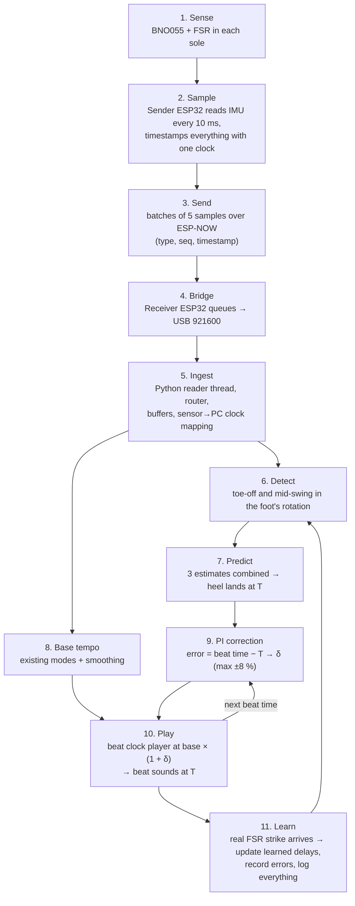

# IMU Research Summary

> The short version of all research and decisions for adding BNO055 IMUs to BrainSync.
> **Status:** research only — nothing is implemented yet.

| Document | What it covers |
|---|---|
| **This file** | Decisions, end-to-end flow, what changes in the code, answers to the key questions — in short |
| [IMU_Integration_Plan.md](IMU_Integration_Plan.md) | Full plan: hardware, firmware, protocols, clock sync, prediction, PI controller, latency, testing, roadmap, file-by-file changes, risks |
| [IMU_Software_Architecture.md](IMU_Software_Architecture.md) | How the software works: diagrams of every layer, what each component does and why, how each piece of data is used for prediction |

---

## 1. Goal

Today the music matches the walker's **tempo** (speed), but beats can land anywhere between steps.
Goal of the POC: make each beat land **exactly on the heel strike** (**phase alignment**), by **predicting** when the foot will hit the ground using IMUs, and nudging the music so the beat arrives at that moment.

Why prediction: sound comes out tens of milliseconds after the PC decides to play it, and the FSR only fires *after* contact. The IMU sees the foot swinging forward ~200–400 ms before it lands — enough warning to schedule the beat early.

---

## 2. Decisions

| Topic | Decision |
|---|---|
| Sensor | **Bosch BNO055 only** (already owned). No other IMU. |
| Placement | **One in each shoe sole**, under the arch (not under heel/ball — FSRs live there), in a rigid enclosure |
| Microcontroller | Both IMUs wired to the **existing single sender ESP32** → one clock for all sensor data |
| Wiring | Each IMU on its **own I2C bus** (left: GPIO 21/22 `Wire`, right: GPIO 18/19 `Wire1`), 100 kHz, twisted cable, strain relief. Fallback: BNO055 UART mode |
| BNO055 mode | **Raw accelerometer + gyroscope** (no fusion): ±16 g (fusion modes clip heel impacts at ±4 g), ±2000 °/s, magnetometer off, 100 Hz |
| FSRs | **Kept** — they are the ground truth for training and evaluation |
| Start | **One IMU on one leg** now (second on order). Built per foot so the second is a config change |
| Prediction | Runs on the PC (Python) for the POC; simple rule-based estimators first, ML only if needed |
| Tempo vs phase | Existing modes keep deciding **tempo**; a new **PI controller** adds a small **phase** correction on top |
| Existing BPM model | **Kept unchanged** — it answers "how fast"; the new predictor answers "exactly when" |

**Check on the boards before wiring:** Adafruit or "GY-BNO055"-style board? On-board I2C pull-ups? ADR and PS1 pins broken out? External crystal?

---

## 3. End-to-end flow

1. **Sense** — BNO055 + FSR in each sole measure motion and pressure.
2. **Sample** — the sender ESP32 reads the IMU(s) every 10 ms and timestamps every sample, strike and foot-lift with one clock.
3. **Send** — batches of 5 samples go over ESP-NOW with type, sequence number and timestamp.
4. **Bridge** — the receiver ESP32 queues packets and forwards them to the PC over USB as prefixed lines (`IMU,…`, `STEP,…`) at 921600 baud.
5. **Ingest** — Python reads lines on its own thread, routes them by type, stores them, and converts sensor time to PC time.
6. **Detect** — the gait detector finds toe-off and mid-swing in each foot's rotation signal.
7. **Predict** — three estimates (toe-off, mid-swing, rhythm), weighted by recent accuracy → *"heel lands at T"*.
8. **Base tempo** — existing modes decide how fast the music should be (existing smoothing).
9. **PI correction** — error = next beat time − T → small tempo nudge δ (max ±8 %).
10. **Play** — the beat clock player runs at base × (1 + δ), so the beat sounds at T, together with the heel strike.
11. **Learn** — the real FSR strike arrives → estimates update their learned delays and error stats; everything is logged.
12. **Repeat** every step. If anything fails, δ fades to 0 → today's tempo-only behavior.

---

## 4. Prediction — how each piece of data is used

| Data | Derived signal | Used for |
|---|---|---|
| **Gyroscope** | Pitch rate (heel-up / toe-up rotation) | The main signal — its shape repeats every stride |
| | Toe-off | Starts the *from toe-off* estimate (~400 ms ahead, rough) |
| | Mid-swing peak | Starts the *from mid-swing* estimate (~200 ms ahead, precise) |
| | Yaw rate | Detects turning → lower confidence |
| **Accelerometer** | Foot still (≈ gravity, no rotation) | Foot on the ground → blocks false detections, resets when standing |
| | Impact spike | Confirms the strike on the IMU side |
| | Gravity direction (calibration) | Aligns axes even if the sensor is mounted crooked |
| **FSR** | Real strike time | Ground truth: measures each estimate's error, learns delays, labels ML data |
| | Step / stride intervals | *From rhythm* estimate; existing BPM model and modes |
| | Foot-lift *(new event)* | Real toe-off time and stance duration |
| *Not used* | Magnetometer, absolute orientation, FSR pressure magnitude | Disturbed / not needed / debugging only |

**The three estimates:**

| Estimate | Formula | Lead time |
|---|---|---|
| From rhythm (baseline = today) | last strike of other foot + median step interval | up to 1 step |
| From toe-off | toe-off time + this foot's median toe-off→strike delay | ~400 ms |
| From mid-swing | mid-swing time + this foot's median mid-swing→strike delay | ~150–250 ms |

**Combined** by weighting each with 1 / (recent error)². Example (real strike at 1000 ms): rhythm 995 (±40), toe-off 1010 (±25), mid-swing 995 (±8) → combined **≈ 996 ± 7**. Delays and errors update every step, so it adapts to each person and speed with no training.

**Optional ML version (LightGBM):** target = time until strike; inputs = last ~250 ms of pitch rate and acceleration, time since toe-off/mid-swing, other foot's state, recent intervals, current music tempo and beat position (walkers entrain to the music), user ID. Labels come free from the FSRs. Always test on sessions not used for training.

---

## 5. The PI controller (PID) — where and why

**Where:** the phase controller, between the strike predictor and the music player. Called from `BPM_estimation.update_bpm()` where today's code calls `player.set_BPM()`.

| Control term | In this system |
|---|---|
| Setpoint | Predicted heel-strike time T |
| Measured value | When the next beat will sound (from the beat clock) |
| Error | beat time − T |
| Output | Tempo correction δ, capped at ±8 % |
| Controlled system | The beat clock player |

- **P** — corrects part of the current error each beat.
- **I** — removes persistent offsets (unmeasured latency, predictor bias, clock drift).
- **D** — not used: natural step variation (±20–30 ms) would make the music jittery.
- **Safety:** dead-band (~10 ms), ±8 % cap, anti-windup, decay to 0 when confidence is low.
- **Runs once per beat**, when a confident prediction exists (around mid-swing).
- **What it absorbs:** prediction errors, inexact latency, clock drift, base-tempo lag during speed changes, natural step variation.

Two loops, two jobs: the existing smoothing makes the **speed** right; the PI loop makes the **beats land on the steps**.

Starting gains: Kp ≈ 0.3–0.5, Ki ≈ 0.02–0.1, Kd = 0. Tune in a simulator first.

---

## 6. Existing smoothing — and what must change

Today: FSR low-pass (sender) → rolling average of 3 intervals (receiver) → 65/35 LGBM blend → mode target (decay + boost) → exponential glide (`_smooth_towards`, ~0.4 s up / ~0.8 s down).

- **Must change:** the glide reads the tempo back from the player, so it would undo the PI nudge. Keep `base_bpm` as its own state, smooth that, and apply `× (1 + δ)` only when sending to the player.
- **Recommended:** make the FSR low-pass time-based (IMU reads slow the sender loop); don't decay the tempo while the IMU shows a foot in swing.
- **Keep:** receiver averaging, LGBM blend, the ~1 s tempo lag.

Details: [Plan §19.1](IMU_Integration_Plan.md#191-existing-smoothing-chain-and-required-changes).

---

## 7. The model part

| Model | Question | Change |
|---|---|---|
| Existing LightGBM BPM model (+ user heads) | How fast? | **Keep.** Fix: split train/test **by session** (row split leaks data); pass session `smoothing_window`/`stride` to `predict_next()` |
| New strike predictor | Exactly when? | **New.** Rule-based first (rhythm → toe-off → mid-swing → combined); LightGBM only if needed |

The 180 existing sessions have no IMU data → the strike predictor needs new recordings.

---

## 8. What changes in the code

| Area | File | Change |
|---|---|---|
| Sender firmware | `ESP32/step_detection_sketch/step_detection_sketch.ino` | IMU slots on `Wire`/`Wire1`, raw-mode config, 10 ms sampler, batching, timestamps on steps, foot-lift event, I2C recovery, status message, remove debug prints |
| Receiver firmware | `ESP32/step_receiver_sketch/step_receiver_sketch.ino` | FreeRTOS queue, non-blocking LED (remove `delay(50)`), 921600 baud, prefixed lines |
| Shared | `ESP32/protocol.h` (new) | Message structs, types, version |
| Input | `server/utils/hardware/sensor_stream.py` (new) | Reader thread, router, per-foot buffers, strike store, clock mapper |
| | `server/utils/hardware/comms.py`, `server/main.py` | New `STEP` format, version check, baud, queue-based main loop |
| Logging | `server/utils/session/logger.py` | Buffered writes; `imu_data.csv`, `strikes.csv`, `predictions.csv`, `beats.csv`, `meta.json` |
| Prediction | `server/utils/gait/events.py` (new), `server/utils/prediction_model/strike_predictor.py` (new) | Gait events; three estimates + combiner |
| Tempo | `server/utils/engine/phase_controller.py` (new), `server/utils/engine/BPM_estimation.py` | PI loop; separate `base_bpm` |
| Music | `server/utils/hardware/midi_player.py` | Rewrite as beat clock player (`time_of_next_beat()`), keep `set_BPM()` |
| GUI | `server/gui_app.py` | Baud, IMU status, phase-alignment settings, IMU calibration |
| Tools / tests | `tools/sim_phase.py`, `evaluate_strike.py`, `tests/` (new) | PI simulator, offline accuracy report, unit tests |
| Cleanup | `server/utils/BPM_estimation.py`, `ESP32/SECRETS.h` | Delete stale duplicate; untrack secrets file |

Full list: [Plan §25](IMU_Integration_Plan.md#25-file-by-file-change-list).

---

## 9. Starting with one IMU

- Only one BNO055 is available now; the single-IMU version is a complete implementation.
- Build **per foot** from day one: IMU slots with `enabled` flags, per-foot `valid` bits in the protocol, per-foot Python objects from config (`imu_feet = ["left"]`), log columns for both feet.
- IMU foot → full prediction; other foot → rhythm estimate + its FSR (less precise). Option: only the IMU foot drives the PI loop.
- Second IMU arrives → wire to `Wire1`, enable, set mirrored axis map, calibrate, `imu_feet = ["left", "right"]`.
- Bonus: same-session comparison of IMU foot vs. FSR-only foot.

---

## 10. Build order

1. **Bring-up** — the IMU prints clean data from the sender; shake/cable test passes.
2. **Stream & log** — full pipeline to the PC; music unchanged.
3. **Offline analysis** — does the IMU predict strikes better than the rhythm baseline? *(go / no-go gate)*
4. **Live prediction** → **beat clock player** → **PI loop** → latency measurement and tuning.
5. **Evaluation** — acoustic beat-vs-step measurement, alignment on vs. off.

---

## 11. Open questions

1. Where is the sender ESP32 worn (waist / thigh / ankle)? → sets cable length, the main hardware risk.
2. Which BNO055 breakout boards exactly? (pull-ups, ADR/PS1 pins, crystal)
3. Which MIDI synth on the demo machine? → sets output latency.
4. Which event defines "the strike": FSR threshold crossing or IMU impact? (decide with data)
5. Beats per step for the songs used (likely 1 for the marches).
6. Target asynchrony (start: |mean| ≤ 20 ms, SD ≤ 30 ms) — confirm with the supervisor.
7. Phase alignment in Random / Manual modes — on or off?
8. Which leg gets the first IMU?
