# Software Architecture — IMU Strike Prediction & Beat Alignment

> Companion to [IMU_Integration_Plan.md](IMU_Integration_Plan.md).
> The plan says *what to build and in which order*. This document explains *how the software works* — every component, what it does, why it exists, and how data moves between them.
>
> **Status:** design only — not implemented yet.
>
> **One IMU first:** only one BNO055 is available now. Every component below is built **per foot** (IMU slots with `enabled` flags, per-foot `valid` bits, per-foot Python objects from config such as `imu_feet = ["left"]`). With one IMU, the other foot is predicted from rhythm + its FSR; adding the second IMU is a configuration change. See [Plan §24.1](IMU_Integration_Plan.md#241-starting-with-a-single-imu).
>
> **Short summary of all decisions:** [IMU_Research_Summary.md](IMU_Research_Summary.md).

---

## Contents

1. [The idea in one paragraph](#1-the-idea-in-one-paragraph)
2. [The big picture](#2-the-big-picture)
3. [Layer 1 — Sender ESP32 firmware](#3-layer-1--sender-esp32-firmware)
4. [Layer 2 — Receiver ESP32 firmware](#4-layer-2--receiver-esp32-firmware)
5. [Layer 3 — Python: getting the data in](#5-layer-3--python-getting-the-data-in)
6. [Layer 4 — Python: understanding the walk](#6-layer-4--python-understanding-the-walk)
7. [Layer 5 — Python: deciding the tempo](#7-layer-5--python-deciding-the-tempo)
8. [Layer 6 — Python: playing the music](#8-layer-6--python-playing-the-music)
9. [Cross-cutting: logging, GUI, configuration](#9-cross-cutting-logging-gui-configuration)
10. [One step, start to finish](#10-one-step-start-to-finish)
11. [Threads and timing](#11-threads-and-timing)
12. [Three clocks and why they matter](#12-three-clocks-and-why-they-matter)
13. [What happens when things go wrong](#13-what-happens-when-things-go-wrong)
14. [Component summary table](#14-component-summary-table)

---

## 1. The idea in one paragraph

Today the music follows the walker's **speed** (tempo). We want the beat to also land **exactly on each footstep** (phase). Sound comes out of the speakers tens of milliseconds after the computer decides to play it, so we can't wait for the foot to land — we must know **in advance** when it will land. A BNO055 IMU in each sole sees the foot swinging forward ~200–400 ms before it hits the ground. The software uses that swing to **predict** the next heel strike, then gently speeds up or slows down the music so the next beat sounds exactly at that moment.

---

## 2. The big picture

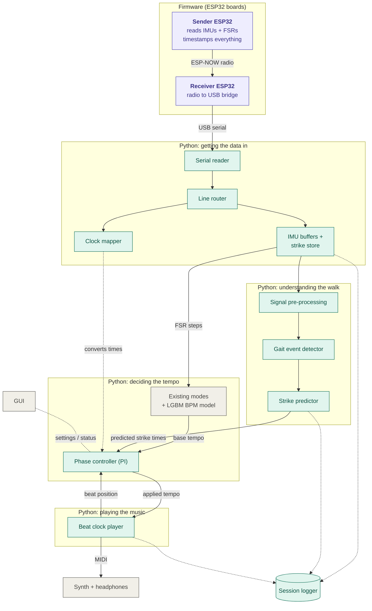

**Legend:** purple = firmware · green = new Python code · gray = existing code (kept, small changes at most)

### 2.1 Complete diagram — every component, including the PI loop

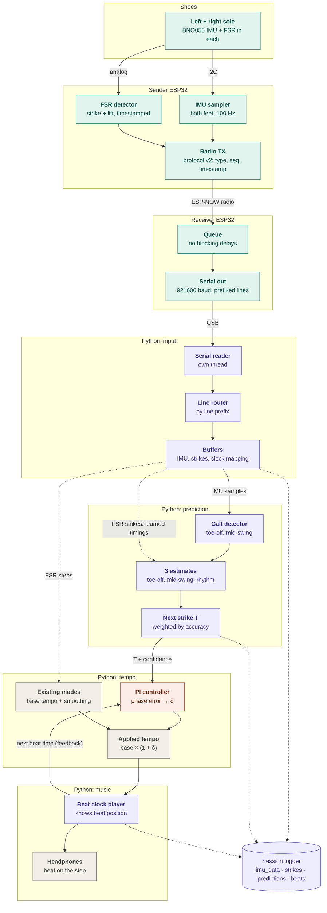

**Legend:** green = shoes and firmware · purple = new Python code · coral = PI phase loop · gray = existing code / output

**How to read it, top to bottom:**

| Layer | Question it answers |
|---|---|
| Firmware | *What happened, and exactly when?* |
| Getting the data in | *How do we receive it reliably and put it on the PC's clock?* |
| Understanding the walk | *Where is each foot in its stride, and when will it land next?* |
| Deciding the tempo | *How fast should the music be, and how much should we nudge it to hit the step?* |
| Playing the music | *Play the notes at exactly the right time, and know where the beats are.* |

---

## 3. Layer 1 — Sender ESP32 firmware

The board worn on the body, wired to both soles.

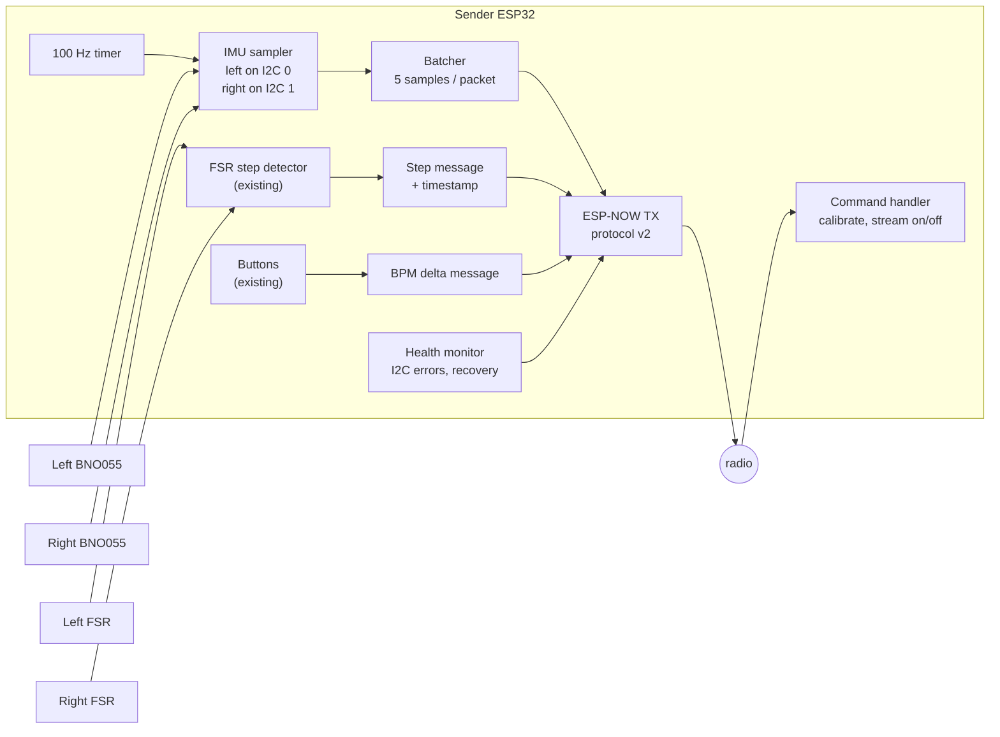

| Component | What it does | Why it exists |
|---|---|---|
| **100 Hz timer** | Ticks every 10 ms. | IMU samples must be evenly spaced. Irregular sampling makes timing analysis unreliable. |
| **IMU sampler** | On each tick: record the timestamp, then read accelerometer + gyroscope from both BNO055s (raw mode, ±16 g, ±2000 °/s). | This is the raw signal of the foot moving. Raw mode avoids clipping at heel impact and avoids the magnetometer, which is disturbed by metal. |
| **Separate I2C buses** | Left foot on one bus, right foot on another. | A broken cable or a stuck sensor on one foot doesn't stop the other foot. |
| **Batcher** | Groups 5 samples (50 ms) into one radio packet. | 20 packets/s instead of 200 — less radio overhead, fewer lost packets. |
| **FSR step detector** | Existing threshold logic. **Change:** now also sends the exact timestamp of the step, plus a new **foot-lift** event (timestamped) when pressure drops below the release threshold. | FSR steps are the **ground truth** — the real moment the foot landed. They label the training data and measure how good the predictions are. |
| **Buttons** | Unchanged. | Manual tempo control. |
| **Command handler** | Receives commands from the PC (calibrate, start/stop IMU stream). | Lets the PC control the sender without reflashing. |
| **Health monitor** | Counts I2C errors per foot, resets a stuck bus, sends a status message once per second. | Long cables to the shoes will occasionally fail. We need to recover automatically and *know* when it happens. |
| **ESP-NOW TX (protocol v2)** | Every message has a header: type, version, sequence number, timestamp. | Sequence numbers reveal lost packets. Version catches mismatched firmware. Timestamp is the key to everything else. |

**The single most important rule in this layer:** *everything is timestamped by the same clock on the same board.* Because both IMUs and both FSRs are on one ESP32, a left-foot sample and a right-foot step can be compared to the microsecond.

---

## 4. Layer 2 — Receiver ESP32 firmware

The board plugged into the PC. It is a **bridge**: radio in, USB out.

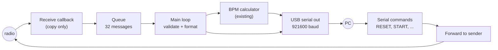

| Component | What it does | Why it exists |
|---|---|---|
| **Receive callback** | Copies the raw packet into a queue and returns immediately. | The radio callback must be fast. **Today** it writes into a single slot, so a second packet arriving before the first is processed **overwrites it** — with IMU data that would lose most packets. |
| **Queue** | Holds up to 32 packets until the main loop handles them. | Absorbs bursts. Overflows are counted and reported. |
| **Main loop** | Checks each packet's version and length, then turns it into a text line. | Rejects corrupt or mismatched packets instead of misreading them. |
| **BPM calculator** | Existing rolling-average BPM for step messages. | Keeps today's behavior and today's modes working. |
| **USB serial out** | Sends one text line per event, starting with a type: `STEP`, `IMU`, `BTN`, `STATUS`, `ACK`… at 921600 baud. | The prefix lets Python tell lines apart. 921600 baud because 115200 is too slow for two IMUs. |
| **Command forwarding** | Existing handshake and calibration commands, plus new ones. | PC → sender control path. |

**Removed:** the `delay(50)` LED blink after each step. It froze the receiver for 50 ms every step, adding delay and dropping data. The LED now blinks without blocking.

---

## 5. Layer 3 — Python: getting the data in

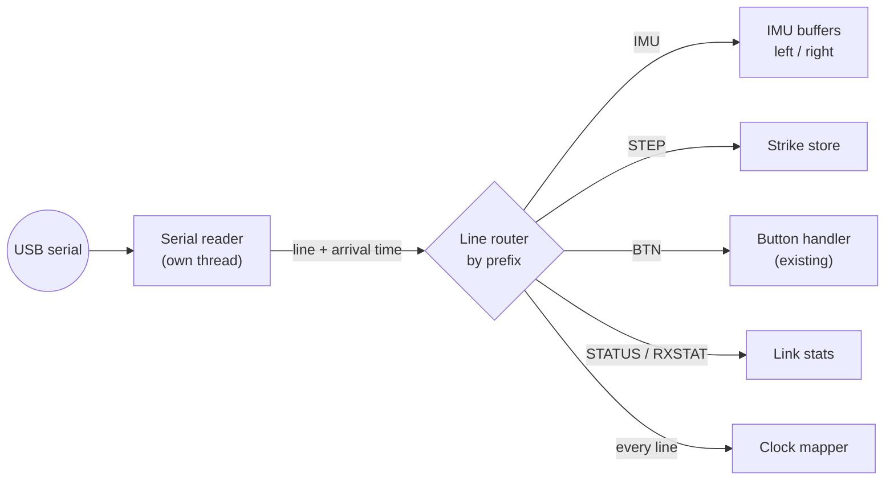

| Component | What it does | Why it exists |
|---|---|---|
| **Serial reader** | A dedicated thread that does nothing but read lines from USB and note the PC time each one arrived. | **Today** the main loop reads one line, updates the tempo, sleeps, reads the next line. With ~120 lines/s that falls behind and adds jitter. A separate thread keeps up. |
| **Line router** | Looks at the first word of each line and sends it to the right handler. Unknown lines are counted, never crash. | **Today** every line is assumed to be a 4-field step line; anything else raises an error and is skipped. |
| **IMU buffers** | One ring buffer per foot holding the last ~10 s of samples, converted to physical units, with gyro bias removed and axes aligned so both feet look the same. | The gait detector and predictor need recent history, fast, without re-parsing text. |
| **Strike store** | List of real foot strikes from the FSRs, with sender timestamps. | Ground truth for training, evaluation, and for the existing tempo modes. |
| **Clock mapper** | Learns the relationship between the sender's clock and the PC's clock, including slow drift. | Predictions are in the **sender's** clock; music is scheduled in the **PC's** clock. Without this conversion, beats drift away from steps over minutes. See [§12](#12-three-clocks-and-why-they-matter). |
| **Link stats** | Counts lost packets (sequence gaps), I2C errors, queue overflows. | Shown in the GUI and logged, so a bad session is visible, not silent. |

---

## 6. Layer 4 — Python: understanding the walk

This is the "brain" that turns raw motion into *"the left heel will land at 12:00:03.412"*.

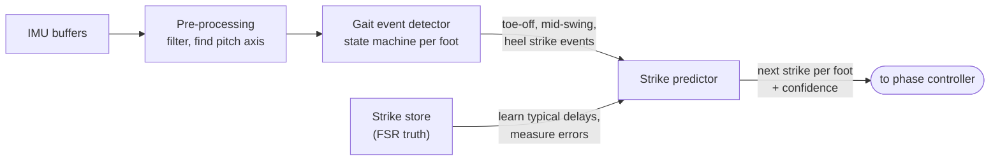

### 6.1 Pre-processing

| What | Why |
|---|---|
| Low-pass filter the gyro and accelerometer (real-time, causal filter). | Removes vibration noise so peaks are found reliably. Causal = uses only past data, because in real time the future isn't available. |
| Find the **pitch axis** — the axis the foot rotates around when walking (heel up / toes up). | That one signal shows the whole step cycle clearly. Found automatically from the data, so exact sensor orientation in the shoe doesn't matter. |

### 6.2 Gait event detector

A small state machine per foot:

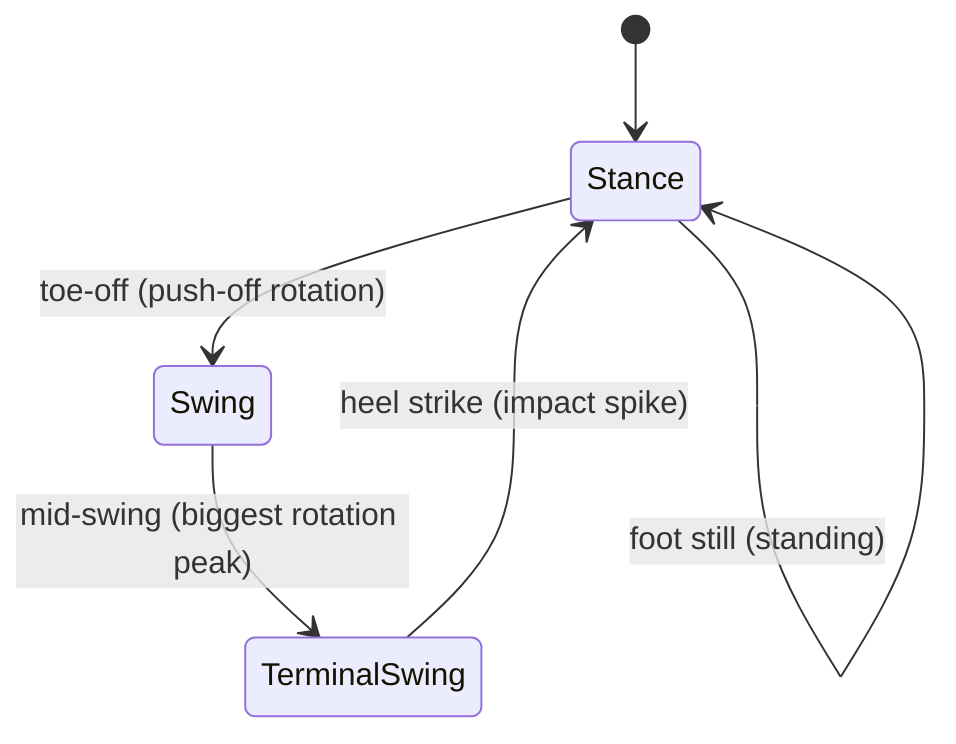

| Event | What it looks like | Why we care |
|---|---|---|
| **Toe-off** | Strong rotation as the foot pushes off the ground. | Earliest warning: ~400 ms before the next strike, but less precise. |
| **Mid-swing** | The largest rotation peak while the foot is in the air. Very repeatable. | Best anchor: ~200 ms before the strike, and precise. |
| **Heel strike** | Sharp acceleration spike on impact. | Confirms the strike (used to learn and check, not to predict). |
| **Stance** | Foot not rotating, acceleration ≈ gravity. | Tells us the foot is on the ground; resets the state machine if it gets confused (standing, turning). |

**Why a state machine:** it enforces the natural order (toe-off → mid-swing → strike) and rejects false detections, e.g. a double peak from a shoe wobble.

### 6.3 Strike predictor — how each piece of data is used

This is the core of the project: turning sensor data into *"the left heel will land at time T"*.

#### 6.3.1 Overview

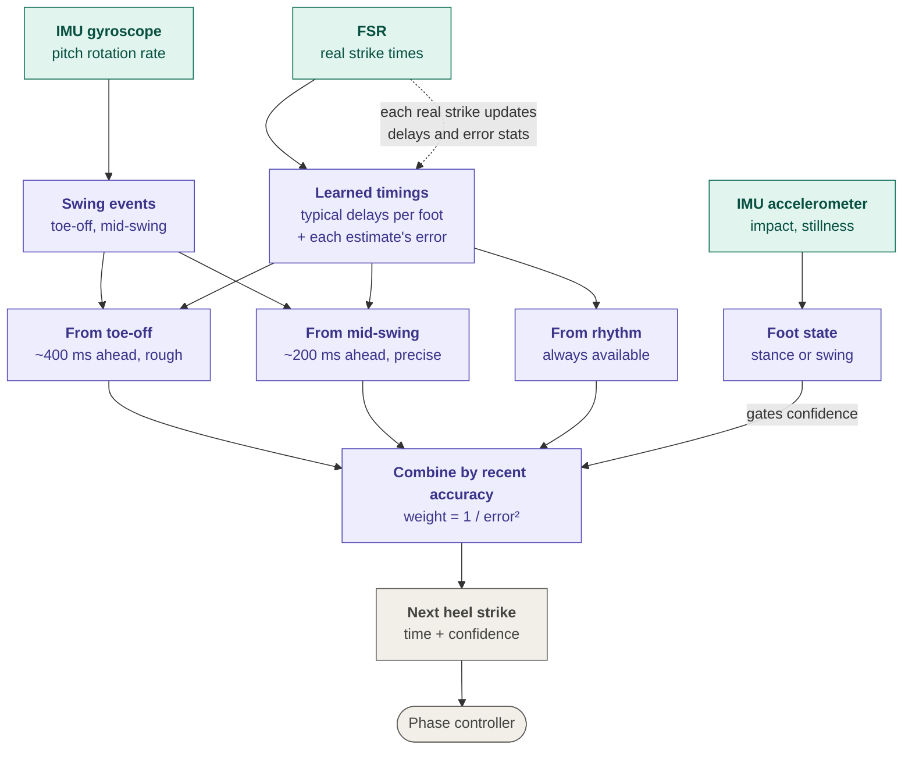

**Legend:** green = raw sensor data · purple = prediction logic · gray = output

#### 6.3.2 What each data source is used for

**IMU gyroscope (3 axes, 100 Hz per foot) — the main predictor**

| Derived signal | How it is computed | Used for |
|---|---|---|
| **Pitch rate** (foot rotating heel-up / toe-up) | Find the axis with the most rotation during walking (automatic), take the rotation speed around it | The core signal. Its shape repeats almost identically every stride. |
| **Toe-off** | Strong push-off rotation at the end of stance | Starts the *from toe-off* estimate |
| **Mid-swing peak** | Largest rotation peak while the foot is in the air | Starts the *from mid-swing* estimate — the most precise one |
| **Yaw rate** (turning) | Rotation around the vertical axis | Detects turns → lowers confidence (turn steps are irregular) |

**IMU accelerometer (3 axes) — detection and confidence, not timing**

| Derived signal | How it is computed | Used for |
|---|---|---|
| **Foot still** | Total acceleration ≈ gravity and almost no rotation | Foot is on the ground → blocks false swing detections, resets the state machine when standing |
| **Impact spike** | Sharp jump in total acceleration | Confirms the strike on the IMU side; compared with the FSR to decide what counts as "the strike" |
| **Gravity direction** | Average during the standing-still calibration | Aligns both feet's axes even if a sensor is mounted crooked |

**FSR — the ground truth the predictor learns from**

| Derived signal | How it is computed | Used for |
|---|---|---|
| **Real strike time** | Threshold crossing, timestamped on the sender ESP32 | (1) Measuring each estimate's error, (2) learning each person's typical delays, (3) labels for ML training |
| **Step / stride intervals** | Time between strikes (other foot / same foot) | The *from rhythm* estimate; also the existing BPM model and modes |
| **Learned delays** (per foot, rolling median of the last ~8 strides) | Toe-off → strike, mid-swing → strike | The numbers the toe-off and mid-swing estimates add to the event time |
| **Foot lift time** *(recommended addition)* | FSR pressure drops below the release threshold — sent as a new event | Real toe-off time and stance duration → checks the IMU's toe-off detection and adds another learned timing. A few lines in the sender: send an event when the flag resets. |

**Not used for prediction**

| Data | Why not |
|---|---|
| Magnetometer | Switched off — disturbed by metal and electronics |
| Absolute orientation | Not needed for timing |
| FSR pressure magnitude | Logged for debugging thresholds only |

#### 6.3.3 The three estimates

| Estimate | Formula | Lead time | Strength | Weakness |
|---|---|---|---|---|
| **From rhythm** | last strike of the other foot + median recent step interval | Up to one step | Always available, no IMU needed | Can't see speed changes coming. This is roughly what the system does today — **the baseline to beat**. |
| **From toe-off** | toe-off time + this foot's median toe-off → strike delay | ~400 ms | Early warning | Swing duration varies, so less precise |
| **From mid-swing** | mid-swing time + this foot's median mid-swing → strike delay | ~150–250 ms | Most precise — the end of the swing is very consistent | Arrives later |

#### 6.3.4 Combining them

Each estimate keeps a running record of its recent errors (measured every time a real FSR strike arrives). The combined prediction weights each estimate by **1 / error²** — the one that has been most accurate recently dominates.

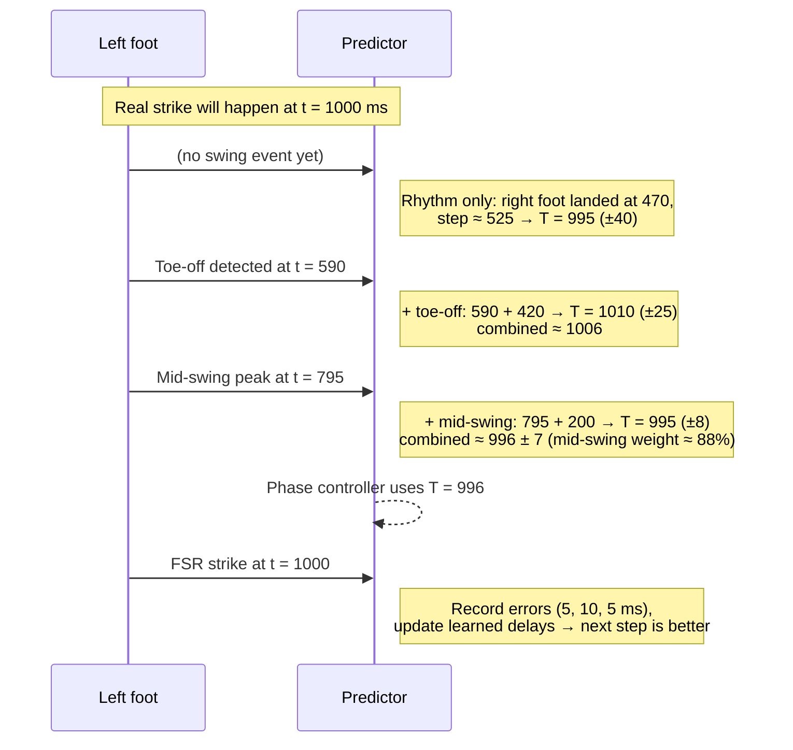

**Properties of this design:**
- **Sharpens over the swing:** rough at toe-off, precise from mid-swing.
- **Adapts automatically** to each person and to speed changes — learned delays update every stride. No training needed to start.
- **Self-measuring:** every step produces an error measurement, so accuracy is always known and logged.
- **Safe:** when foot state looks wrong (standing, turning, shuffling), confidence drops and the phase controller backs off.

#### 6.3.5 Optional: ML version

Only if the combined estimate isn't accurate enough. Use LightGBM (same tooling as the existing BPM model).

**Target:** time remaining until the next strike (ms), labelled by the FSR — every recorded step becomes free training data.

**Inputs, at any moment during swing:**

| Group | Features |
|---|---|
| Gyroscope | Last ~250 ms of pitch rate (downsampled), peak so far in this swing, time since the peak |
| Accelerometer | Last ~250 ms of total acceleration |
| Events | Time since toe-off, time since mid-swing, current state |
| Other foot | Its state, time since its last strike |
| Rhythm | Last 4 step intervals, swing durations, mid-swing → strike delays |
| Music | Current tempo and beat position — people unconsciously adjust their steps to the music, so the music itself helps predict the next step |
| User | User ID / per-user model (same idea as the existing "user head") |

**Evaluation:** always test on sessions (and ideally people) not used for training. Compare against the *from rhythm* baseline at the same lead time.

## 7. Layer 5 — Python: deciding the tempo

Two separate jobs, deliberately kept apart:

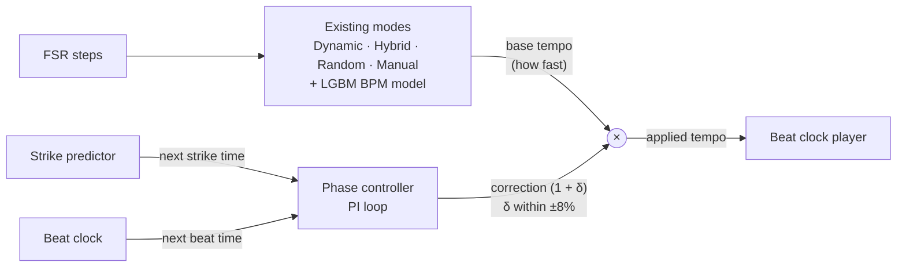

### 7.1 Existing modes + BPM model — *"how fast?"*

| What | Change |
|---|---|
| Dynamic, Hybrid, Random, Manual modes and the LightGBM BPM model decide the **base tempo**, exactly as today. | Only one change: instead of setting the player's tempo directly, they hand the base tempo to the phase controller. |

**Why keep them:** they already work and are tuned. Tempo and phase are different problems.

### 7.2 Phase controller — *"how do we land the beat on the step?"*

Once per beat:

1. **Error** = (time the next beat will sound) − (predicted time of the matching heel strike), after subtracting the measured audio latency.
2. **PI controller** turns that error into a small correction δ:
   - **P (proportional):** corrects part of the current error — *"the beat is 40 ms late, speed up a bit."*
   - **I (integral):** corrects errors that persist — *"we've been ~15 ms late for 10 beats, so there's a constant offset; remove it."* This catches unmeasured latency and prediction bias.
   - **No D term:** steps naturally vary by ±20–30 ms; a D term would amplify that noise into jittery music.
3. **Safety limits:**
   - δ is capped at **±8 %** so the music never audibly lurches.
   - **Dead-band:** errors under ~10 ms are ignored, to avoid constant hunting.
   - **Anti-windup:** when the cap is hit or confidence is low, the I term stops growing and slowly fades.
   - **Low confidence** (standing, turning): δ fades to 0, so the system behaves exactly like today.
4. **Beat pairing:** decides which beat belongs to which step (nearest beat at first, then consecutive beats ↔ consecutive steps), so the controller doesn't flip between targets.

**Applied tempo = base tempo × (1 + δ).** With phase alignment switched off, δ = 0 and nothing changes compared to today.

**Why PI is the right tool:** a PI loop on phase is a **phase-locked loop** — the standard technique for locking one rhythm onto another. The base tempo from the modes gets the speed roughly right (feed-forward); the PI loop does the fine timing (feedback).

---

## 8. Layer 6 — Python: playing the music

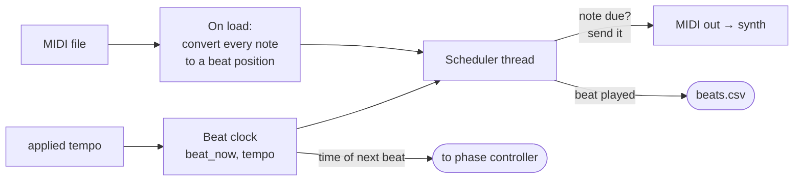

| Component | What it does | Why it exists |
|---|---|---|
| **Pre-processing on load** | Converts every note in the MIDI file from "seconds" to "beat number" (e.g. note at beat 37.5). | **Today** the player only knows "wait X seconds, then play", stretched by a tempo factor. It has **no idea where the beats are**, so it can't line them up with anything. |
| **Beat clock** | Keeps the current position in beats and the current tempo. Advances smoothly as time passes. | Can answer *"when will beat 38 sound?"* — the question the phase controller needs answered every beat. |
| **Scheduler thread** | Sleeps until the next note's beat position is reached, then sends it. Re-plans immediately when tempo changes. | Precise note timing (target: < 3 ms jitter). Kept on its own thread with minimal work so other processing can't delay it. |
| **Beat logging** | Records when each beat was sent and the tempo/correction at that moment. | Needed to measure how close beats landed to steps. |

**Kept compatible:** the existing `set_BPM()` call still works, so the current modes don't need rewriting.

---

## 9. Cross-cutting: logging, GUI, configuration

### 9.1 Session logger

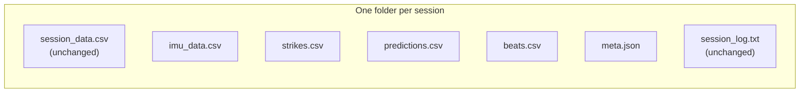

| File | Contents | Why |
|---|---|---|
| `session_data.csv` | Same as today. | Existing analysis tab and BPM-model training keep working. |
| `imu_data.csv` | Every IMU sample, both feet, raw values + sender timestamp. | Raw data can be re-processed later with better algorithms. |
| `strikes.csv` | Every FSR strike with sender timestamp. | Ground truth. |
| `predictions.csv` | Every prediction: when it was made, what it predicted, which method. | Measure prediction accuracy vs. how early the prediction was made. |
| `beats.csv` | Every beat: when sent, tempo, correction, phase error. | Measure beat-to-step alignment. |
| `meta.json` | Firmware version, sensor settings, calibration, clock fit, latency, mode settings. | Makes every session reproducible and self-describing. |

**Change from today:** the logger keeps files open and writes in batches. Today it opens and closes the file for every row — fine at 10 rows/s, too slow at 100+.

### 9.2 GUI

| Addition | Why |
|---|---|
| IMU status: connected, lost packets, I2C errors | See problems immediately, not after the session. |
| Phase alignment on/off, latency, controller gains | Experiment without editing code. |
| Calibration also records IMU while standing still | Gyro bias and "which way is down" for each foot. Reuses the existing "stand still" calibration step. |
| Optional debug plot: foot rotation + strikes + beats | The fastest way to see if detection and alignment work. |

### 9.3 Configuration

All new settings (baud, phase alignment, latency, gains, limits, beats per step, prediction method) are **command-line arguments** to `main.py`, set from the GUI — same pattern as today's settings.

---

## 10. One step, start to finish

What happens during a single left-foot step, in order:

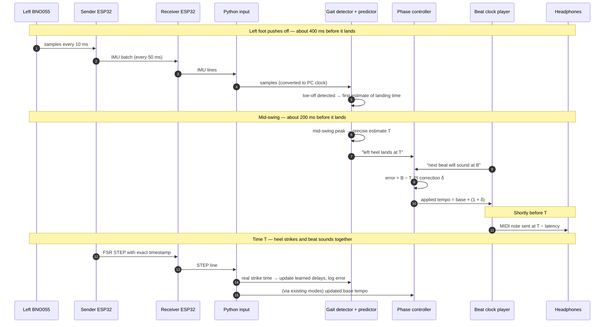

---

## 11. Threads and timing

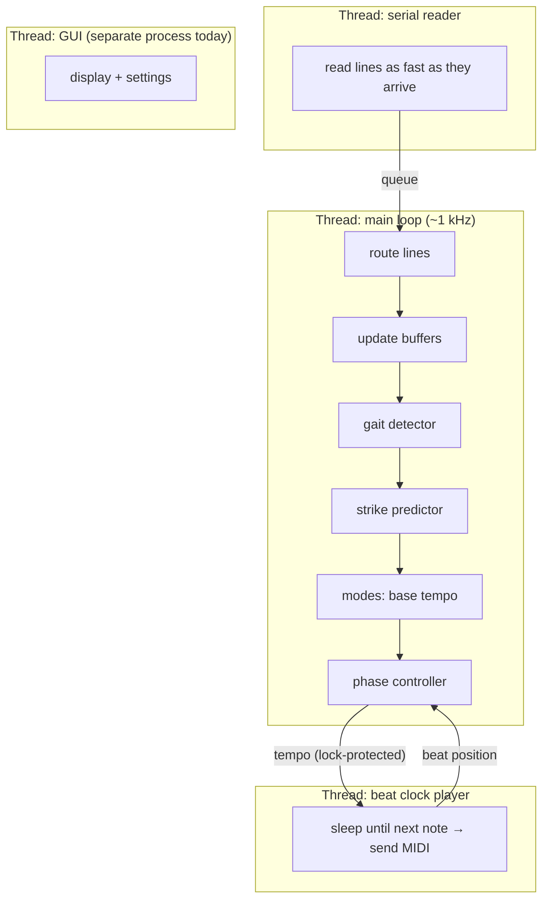

| Thread | Why separate |
|---|---|
| Serial reader | Never miss or delay incoming data. |
| Main loop | All the thinking. Each step must stay fast (budget < 1 ms) so it runs ~1000×/s. |
| Beat clock player | Note timing must not be delayed by anything else. Minimal work inside. |
| GUI | Already a separate process today; communicates via the existing stdin/stdout protocol. |

---

## 12. Three clocks and why they matter

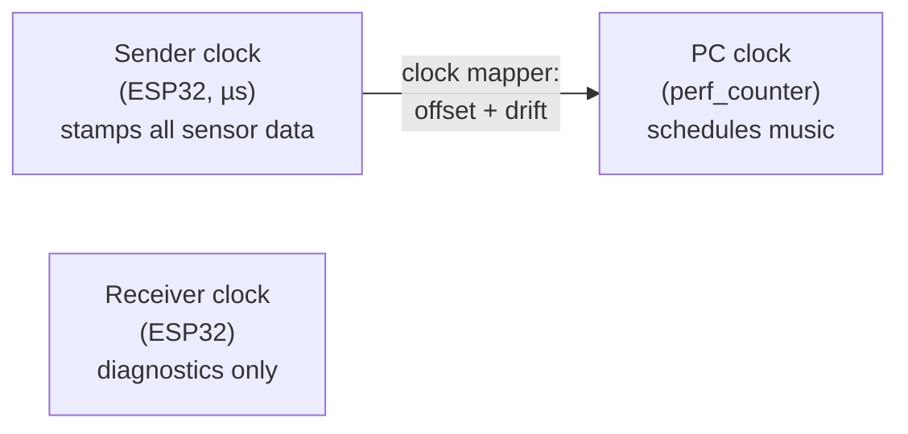

| Clock | Role |
|---|---|
| **Sender clock** | The truth for *when things happened* — every IMU sample and every FSR strike. |
| **Receiver clock** | Not used for timing. |
| **PC clock** | When music is played. |

The PC can't just use "when the line arrived" as the event time — USB delivery delay varies by several milliseconds. Instead, the **clock mapper** watches the *smallest* delay seen over recent seconds (that's the true offset plus the minimum transport time) and tracks how it slowly drifts (crystals differ by a few ms per minute). This gives a stable conversion from sender time to PC time.

---

## 13. What happens when things go wrong

| Situation | What the system does | Result for the user |
|---|---|---|
| A few IMU packets lost | Sequence gap counted; predictor uses what it has. | No audible effect. |
| One foot's IMU fails (cable) | Sender resets that I2C bus; predictor relies on the other foot + rhythm. | Slightly less precise alignment. |
| Both IMUs fail | Predictor confidence drops to 0 → phase correction fades to 0. | Music behaves exactly like today (tempo only). |
| Walker stops or turns | Gait detector sees irregular/no steps → low confidence. | Phase correction fades; existing slowdown logic takes over. |
| Firmware/Python version mismatch | Version check at handshake fails. | Clear error message: "reflash firmware". |
| Python busy (CPU spike) | Player thread is independent; notes still on time. | Possibly one less-accurate correction, no audible glitch. |

**Design principle:** every new part can fail back to today's behavior. Phase alignment is an *addition* on top of tempo following, never a replacement.

---

## 14. Component summary table

| # | Component | Where | New / changed | One-line purpose |
|---|---|---|---|---|
| 1 | IMU sampler + batcher | Sender ESP32 | New | Read both feet' motion every 10 ms, send in groups |
| 2 | FSR step detector | Sender ESP32 | Changed (timestamp) | Ground-truth foot strikes |
| 3 | Protocol v2 | Both ESP32s | New | Messages with type, version, sequence, timestamp |
| 4 | Health monitor | Sender ESP32 | New | Detect and recover from cable/sensor errors |
| 5 | Receive queue | Receiver ESP32 | New | Stop packets overwriting each other |
| 6 | Serial output v2 | Receiver ESP32 | Changed | Prefixed lines at 921600 baud |
| 7 | Serial reader | Python | New | Read all incoming data without falling behind |
| 8 | Line router | Python | New | Send each line type to the right place |
| 9 | Clock mapper | Python | New | Convert sensor time → PC time, including drift |
| 10 | IMU buffers / strike store | Python | New | Recent motion history and real strikes |
| 11 | Gait event detector | Python | New | Find toe-off, mid-swing, heel strike |
| 12 | Strike predictor | Python | New | Predict when each heel will land |
| 13 | Existing modes + LGBM BPM model | Python | Small change | Decide how fast (base tempo) |
| 14 | Phase controller (PI) | Python | New | Nudge tempo so beats land on steps |
| 15 | Beat clock player | Python | Rewritten | Know where the beats are; play notes precisely |
| 16 | Session logger | Python | Extended | Record everything needed to evaluate |
| 17 | GUI | Python | Extended | Status, settings, calibration |

For the build order, testing, and risks, see [IMU_Integration_Plan.md](IMU_Integration_Plan.md).
